# Full-Stack Deployment & DevOps Mastery: Spring Boot + PostgreSQL/MySQL
## Complete Curriculum & Technical Architecture Specification

> **Document Purpose:** Single source of truth for building an interactive learning module inside an existing Java/Rust/PostgreSQL course platform. This file will be consumed by Claude.ai to generate frontend playground components, terminal simulators, visualizers, and lesson content. Every structural element is unambiguous and machine-parseable.
>
> **Audience:** Learners from non-IT backgrounds. Every technical concept is preceded by a visual, physical-world analogy. No prior server, Linux, or networking knowledge is assumed.
>
> **Core App Deployed Across All 8 Stages (constant throughline):** One identical Java 17/21 Spring Boot application (Spring Web + Spring Data JPA/Hibernate) backed by either PostgreSQL or MySQL. The app exposes REST endpoints (`/api/orders`, `/api/health`), connects via JDBC, and uses Spring Actuator. Learners never rewrite the app — they only evolve *how* it is deployed.

---

## 0. Course Meta-Architecture

### 0.1 The 8-Stage Progression Ladder

| Stage | Era Name | The Big Idea Unlocked | The Pain That Unlocks the Next Stage |
|---|---|---|---|
| 1 | Manual Bare-Metal / VPS | "I can get a .jar onto a remote Linux box and run it." | Server reboots kill the app; raw port 8080 is exposed; every deploy is 20 manual commands. |
| 2 | systemd + Nginx Hardening | "The app restarts itself, is reachable on port 80/443, and survives reboots." | JAR uploads cause downtime mid-request; secrets live in plaintext configs; human typos. |
| 3 | Shell Automation | "One script deploys atomically with zero downtime and automatic backups." | "Works on my laptop, crashes on the server" — environment drift, dependency conflicts. |
| 4 | Docker Containerization | "The app ships inside a sealed box that runs identically everywhere." | 15-line `docker run` incantations, strict startup order, one host is a single point of failure. |
| 5 | Docker Compose | "One YAML file orchestrates app + DB + proxy with health-gated startup." | Single host limit; traffic spikes kill one machine; no fleet thinking. |
| 6 | Cloud & Managed Services | "VPC, subnets, security groups, managed RDS, load balancers." | Developers still build/push manually; broken code reaches production with no automated tests. |
| 7 | CI/CD Pipelines | "Every push is automatically tested, scanned, built, deployed, and health-checked." | Cannot scale individual services; no canary rollouts; manual fleet ops don't scale. |
| 8 | Kubernetes | "An autonomous fleet commander keeps the desired number of pods alive, scales, and heals." | (Course summit — mastery demonstrated.) |

### 0.2 The 4 Mandatory Learning Pillars (applied to EVERY stage)

1. **`imagine_card`** — a physical-world analogy a 10-year-old could picture, placed *before* any technical term.
2. **`architecture_flow`** — ASCII box-and-arrow diagram **and** Mermaid `flowchart LR` / `sequenceDiagram` for every stage, including a **Before vs. After Upgrade** diff diagram.
3. **`comparison_tables`** — problem→solution tables, tool-translation tables (GUI click ↔ CLI), and port/protocol/config cheat-sheets.
4. **`chaos_lab`** — 2–3 deliberately injected failures per stage, each with Symptom → Imagine-analogy → Diagnostic trail → Exact fix.

### 0.3 The Split-Screen Interactive Playground (Global UI Contract)

Every lab renders in a two-pane environment. Claude.ai must implement this layout identically for all stages:

```
┌──────────────────────────────────────────────────────────────────────┐
│  TOP-RIGHT: LIVE VISUAL TOPOLOGY MAP                                  │
│  [Your Laptop]──SSH/SFTP──▶[VPS/Cloud Box]──▶[Database]              │
│   badges: 🟢 RUNNING  🔴 CRASHED  🟠 502 BAD GATEWAY  🔴 DB_CONN_REFUSED│
├──────────────────────────────────────────────────────────────────────┤
│  LEFT/BOTTOM: SIMULATED INTERACTIVE TERMINAL                          │
│  learner@server:~$ █   (bash, pipes, grep, tail -f, vim/nano, ssh)   │
│  Stage 1 bonus: dual-pane FileZilla-style SFTP simulator             │
└──────────────────────────────────────────────────────────────────────┘
```

- **Terminal Validation Rules (global):** Every lab step lists an *Expected Output* string that the simulator must check. Wrong command → the simulator shows the real-world error, not a generic "wrong."
- **Simulated Server State:** A hidden JSON state machine (see Section 4 schema `SimulatedServerState`) tracks: `java_installed`, `db_running`, `app_pid`, `port_8080_listening`, `nginx_config_valid`, `disk_usage_pct`, `docker_containers`, `k8s_pods` — so break-fix labs behave causally.

---

# STAGE 1 — Manual Bare-Metal / VPS Deployment (The PuTTY & FileZilla Era)

## 1A. imagine_card: "Your First Empty Shop"

> **Imagine you are opening a street-corner shop in a city you've never visited.**
> - The **VPS (virtual private server)** is the *empty, unfurnished shop* you rent from a real-estate company (AWS, DigitalOcean, Hetzner). You get a street address — that's the **IP address**.
> - **FileZilla (SFTP)** is the *delivery van* you drive yourself. You load boxes (your `.jar` file) into the van, drive to the shop's address, and carry each box to a specific shelf (the `/opt/myapp` folder).
> - **PuTTY (SSH)** is the *walkie-talkie* connecting you — standing outside — to a worker inside the shop. You speak commands ("switch on the lights," "start the oven") and the worker does them. You never enter the shop yourself; everything happens through the walkie-talkie.
> - The **database** is the *stockroom* in the back of the shop. The **port number** is the *door number*: customers knock on door **8080** to reach your Java kitchen; your kitchen staff knock on door **5432** (PostgreSQL) or **3306** (MySQL) to reach the stockroom. Same building (localhost), different doors.
> - **The .pem SSH key** is the *one-of-a-kind skeleton key* the real-estate company mails you. If you photocopy it and leave it on a park bench (permissions `644`), anyone can enter your shop — so Linux insists you keep it in your pocket only (`chmod 400`).

## 1B. architecture_flow

### Stage 1 Request Flow (ASCII)

```
   LEARNER'S LAPTOP                          REMOTE VPS (Ubuntu 22.04)
 ┌───────────────────────┐                 ┌────────────────────────────────┐
 │  mvn clean package    │                 │                                │
 │  └──▶ target/app.jar  │                 │   FileZilla SFTP  :22 ──▶ /opt/ │
 │         │             │   SFTP upload   │                                │
 │         ▼             │ ──────────────▶ │   PuTTY SSH       :22 ──▶ bash │
 │  FileZilla (GUI van)  │                 │        │                       │
 │  PuTTY    (walkie-    │   SSH session   │        ▼                       │
 │           talkie)     │ ◀────────────── │   java -jar app.jar            │
 └───────────────────────┘                 │        │ listens on :8080      │
        ▲                                  │        ▼                       │
        │  http://203.0.113.10:8080/api/orders              ┌─────────────┐ │
        └───────────────────────────────────────────────────│ PostgreSQL  │ │
                                   HTTP :8080               │  :5432      │ │
                                                            └─────────────┘ │
                                             (same machine: "localhost")    │
                                             └────────────────────────────────┘
```

### Stage 1 Mermaid

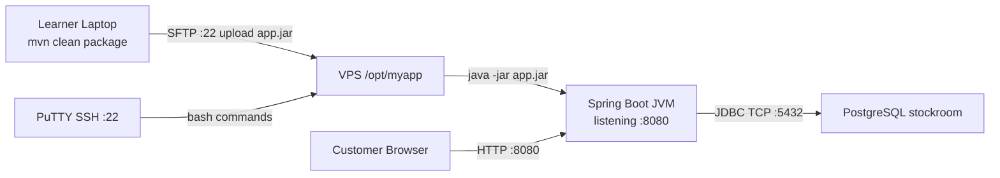

### Step-by-Step Deployment Lab (with Terminal Validation Rules)

**Lab 1.1 — Build the artifact locally**

| # | Learner Action | Terminal Validation Rule (Expected Output) |
|---|---|---|
| 1.1.1 | Run `mvn clean package` | Simulator must show `BUILD SUCCESS` and that `target/shop-app-1.0.0.jar` exists (~40 MB, "fat jar" with embedded Tomcat). |
| 1.1.2 | Run `ls -lh target/*.jar` | Must list exactly one `.jar`; if learner sees `*.jar: No such file`, simulator hints "did the build fail above?" |

**Lab 1.2 — FileZilla upload (dual-pane SFTP simulator)**

Tool-Translation Table — *What you click vs. what really happens:*

| FileZilla GUI Action | Under-the-hood Linux equivalent |
|---|---|
| Type `sftp://203.0.113.10`, user `ubuntu`, port 22, click Quickconnect | `sftp ubuntu@203.0.113.10` then password/key auth |
| Drag `app.jar` from left pane (local `target/`) to right pane (`/opt/myapp/`) | `scp target/app.jar ubuntu@203.0.113.10:/opt/myapp/` or inside `sftp>`: `put target/app.jar /opt/myapp/` |
| Right pane refresh shows file | `ls -lh /opt/myapp` |
| Disconnect button | `exit` (closes TCP session on port 22) |

CLI equivalence drill (terminal pane): `scp -i ~/.ssh/deploy.pem target/app.jar ubuntu@203.0.113.10:/opt/myapp/` → validation: `ls -lh /opt/myapp/app.jar` on remote shows uploaded size matching local.

**Lab 1.3 — PuTTY login & first reconnaissance**

| # | Command | Expected Output (validation string) |
|---|---|---|
| 1.3.1 | `ssh -i ~/.ssh/deploy.pem ubuntu@203.0.113.10` | Banner `Welcome to Ubuntu 22.04`, prompt becomes `ubuntu@shop-server:~$`. Wrong key → `Permission denied (publickey)`. |
| 1.3.2 | `whoami && hostname && pwd` | `ubuntu`, `shop-server`, `/home/ubuntu` |
| 1.3.3 | `ip addr show \| grep inet` | Shows `203.0.113.10` — "the street address of your shop." |
| 1.3.4 | `sudo apt update && sudo apt install -y openjdk-17-jre-headless` | `Setting up openjdk-17-jre-headless ...` → validation: `java -version` prints `openjdk version "17.0.x"`. |
| 1.3.5 | `sudo apt install -y postgresql` | `Setting up postgresql ...` → validation: `sudo systemctl status postgresql` shows `active (running)` in green. |

**Lab 1.4 — Database user & schema creation**

```sql
sudo -u postgres psql
CREATE USER shopuser WITH PASSWORD 'ShopPass123!';
CREATE DATABASE shopdb OWNER shopuser;
GRANT ALL PRIVILEGES ON DATABASE shopdb TO shopuser;
\q
```
Validation: `psql -h localhost -U shopuser -d shopdb -c "SELECT 1;"` returns `1 row`. MySQL track: `sudo mysql` → `CREATE USER 'shopuser'@'localhost' IDENTIFIED BY 'ShopPass123!';` `CREATE DATABASE shopdb;` `GRANT ALL ON shopdb.* TO 'shopuser'@'localhost';` → validated by `mysql -u shopuser -p shopdb -e "SELECT 1;"`.

**Lab 1.5 — Run the app the naive way (this sets up the pain)**

| # | Command | Expected Output |
|---|---|---|
| 1.5.1 | `cd /opt/myapp && java -jar app.jar &` | Log line `Tomcat started on port 8080 (http) with context path '/'` |
| 1.5.2 | `curl http://localhost:8080/api/health` | `{"status":"UP"}` |
| 1.5.3 | `ss -tlnp \| grep 8080` | `LISTEN 0 100 ... *:8080 ... users:(("java",pid=2142,...))` |
| 1.5.4 | (from laptop) `curl http://203.0.113.10:8080/api/orders` | JSON list of orders — **the shop is open to the world!** |

**Lab 1.6 — Survive the hangup: nohup**

| # | Command | Expected Output |
|---|---|---|
| 1.6.1 | `pkill -f 'java -jar app.jar'` then `nohup java -jar app.jar > app.log 2>&1 &` | `[1] 2317` plus log written to `app.log` |
| 1.6.2 | `tail -f app.log` then Ctrl-C | Learner sees logs stream, learns Ctrl-C only stops *watching*, not the app (`ps aux \| grep java` still shows PID 2317). |

## 1C. Chaos Labs (Deliberate Failures)

**Chaos 1.1 — "The Walkie-Talkie Ran Out of Batteries" (closing PuTTY kills Java)**

- **Symptom:** App worked; learner closed PuTTY; app now unreachable (`curl: Connection refused`).
- **Imagine:** You told the worker "keep the oven on," but the moment your walkie-talkie battery died, the worker's contract said "stop everything when the boss hangs up." SSH sessions send a *hangup signal* (`SIGHUP`) to every child process when they close — unless the process is told to ignore it.
- **Diagnostic trail:** Reconnect SSH → `curl localhost:8080/api/health` → `Connection refused` → `ps aux | grep java` → nothing → `history | grep 'java -jar'` → shows it was run WITHOUT `nohup`.
- **Exact fix:** `nohup java -jar app.jar > app.log 2>&1 &` — or better, `setsid java -jar app.jar ...`. Validate: disconnect & reconnect, `curl` still returns `UP`.

**Chaos 1.2 — "Two Chefs Fighting for One Kitchen Door" (port already bound)**

- **Symptom:** `java -jar app.jar` crashes with `BindException: Address already in use` / `Web server failed to start. Port 8080 was already in use`.
- **Imagine:** A new chef arrives, tries to hang his sign on kitchen door 8080, but the old chef's sign is still there. One door, one sign — Linux refuses.
- **Diagnostic trail:** `ss -tlnp | grep 8080` → reveals PID 2142 still listening (a zombie from Chaos 1.1) → `ps aux | grep 2142`.
- **Exact fix:** `kill 2142` (graceful) or `kill -9 2142` (last resort). Re-run. Validate: `ss -tlnp | grep 8080` shows exactly ONE java PID.

**Chaos 1.3 — "Knocking on the Wrong Door in the Wrong Building" (JDBC connection refused)**

- **Symptom:** App starts then dies: `Connection to localhost:5432 refused` — but learner insists PostgreSQL is running.
- **Imagine:** The kitchen staff were told to fetch stock from "the building at address localhost." But the stockroom moved to the building next door (or the DB listens only on a socket, or the DB runs on a *different server* and the app config still says `localhost`).
- **Diagnostic trail:** `sudo systemctl status postgresql` → `active` → `ss -tlnp | grep 5432` → **empty** (DB only listening on unix socket!) → check `application.properties`: `spring.datasource.url=jdbc:postgresql://localhost:5432/shopdb` → credentials user `shopuser`.
- **Exact fix:** Edit `/etc/postgresql/14/main/postgresql.conf` → `listen_addresses = 'localhost'` → `sudo systemctl restart postgresql` → `ss -tlnp | grep 5432` now shows listener → restart app. (Variant B for later stages: change JDBC URL host from `localhost` to the real DB IP.)

**Chaos 1.4 — "The Photocopied Skeleton Key" (.pem permission denied)**

- **Symptom:** `ssh -i deploy.pem ubuntu@203.0.113.10` → `Permissions 0644 for 'deploy.pem' are too open ... It is required that your private key files are NOT accessible by others.` → `Permission denied (publickey)`.
- **Imagine:** You left a photocopy of your shop's skeleton key on a public park bench. The security guard at the shop refuses to even look at your key now.
- **Diagnostic trail:** `ls -l deploy.pem` → `-rw-r--r--` (everyone can read!).
- **Exact fix:** `chmod 400 deploy.pem` → retry SSH → success. Validate: `ls -l deploy.pem` shows `-r--------`.

## 1D. Pain Point Table → unlocks Stage 2

| # | Operational Pain Felt by Learner | Root Cause | Why Manual VPS Era Fails at Production Scale |
|---|---|---|---|
| P1.1 | Power company maintenance reboots the VPS at 3 AM; the shop is dead in the morning and customers see `Connection refused`. | `java -jar` is tied to an SSH session or a manual shell — nothing restarts it. | No process supervision. |
| P1.2 | Users must type `:8080` in the browser; no padlock icon; company policy forbids non-HTTPS. | Java serves raw HTTP on a non-standard port; no TLS termination. | No reverse proxy, no SSL. |
| P1.3 | Uploading a new JAR means `pkill java`, upload, restart — users mid-order get dropped errors. | No atomic swap, no rolling anything. | Downtime on every deploy. |
| P1.4 | The DB password sits inside `application.properties` readable by any user on the box. | Secrets baked into the artifact. | Security violation. |
| P1.5 | Twenty typed commands per deploy → one typo (wrong IP, wrong folder) wastes 20 minutes. | Humans are the deployment engine. | Error-prone, non-repeatable. |

**Unlock gate:** Learner must (1) reproduce Chaos 1.1 and fix it, (2) answer quiz: "Why did the app die when PuTTY closed?" (SIGHUP), (3) screenshot-equivalent: `ss -tlnp` showing both 8080 and 5432.

### Before vs. After Upgrade Diagram (Stage 1 → Stage 2)

```
BEFORE (Stage 1)                          AFTER (Stage 2)
┌──────────────────────────┐             ┌──────────────────────────────────┐
│ Customer ──:8080────▶    │             │ Customer ──:443 HTTPS──▶        │
│   java (dies on reboot)  │      ▶▶     │   Nginx receptionist           │
│   nohup hack             │             │      └──▶ :8080 java           │
│ password in jar          │             │   systemd auto-restart on boot │
│ DB :5432 open to world   │             │   UFW firewall, .env secrets   │
└──────────────────────────┘             └──────────────────────────────────┘
```

---

# STAGE 2 — Production Linux Hardening, systemd & Nginx Reverse Proxy

## 2A. imagine_card: "The Receptionist and the Backup Generator"

> **Imagine your little shop has grown into a busy office building.**
> - **systemd** is the building's *automatic backup generator + building manager*. When the city's power flickers (server reboot), the generator kicks in within seconds and every office light comes back on in the right order — nobody has to run around with a flashlight. systemd also keeps a *logbook* of everything (`journalctl`).
> - **Nginx** is the *receptionist at the front desk* (doors 80 and 443). Visitors never wander the hallways. They hand their request to the receptionist, who checks ID and SSL badge, then phones the right internal cabin — your Java kitchen at extension **8080** — and relays the answer back. Strangers never learn the internal extension numbers; the hallway map is hidden.
> - **UFW firewall** is the *security guard with a guest list*: only doors 22 (walkie-talkie), 80 and 443 (front desk) may be used. Door 8080 and 5432 are now *staff-only doors* — chained from the inside.
> - **Certbot/Let's Encrypt** is the *free government ID badge printer*: it gives your receptionist an official HTTPS badge so visitors trust the front desk.

## 2B. architecture_flow

### Stage 2 Request Flow (ASCII)

```
Customer Browser ──HTTPS :443──▶ ┌────────────────── VPS ───────────────────────┐
  (padlock 🔒)                    │  Nginx front desk :443 (TLS terminated here) │
                                  │      │ proxy_pass http://127.0.0.1:8080      │
                                  │      ▼                                       │
                                  │  systemd ┌──────────────────────────────┐    │
                                  │  manager │ springboot.service           │    │
                                  │  restarts│  └─ java -jar /opt/myapp/... │    │
                                  │  on boot └───────────┬────────────────────┘    │
                                  │  journalctl -u       │ JDBC :5432              │
                                  │  springboot          ▼ (loopback only)        │
                                  │            ┌──────────────┐                   │
                                  │            │ PostgreSQL   │                   │
                                  │            │ socket 5432  │                   │
                                  │            └──────────────┘                   │
                                  │  UFW: ALLOW 22,80,443 / DENY 8080,5432        │
                                  └───────────────────────────────────────────────┘
```

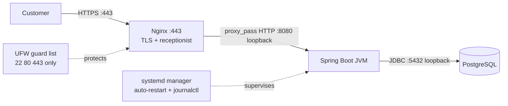

### Step-by-Step Lab (with Terminal Validation Rules)

**Lab 2.1 — systemd service file (the building manager's job description)**

```ini
# /etc/systemd/system/springboot.service
[Unit]
Description=Shop Spring Boot App
After=network.target postgresql.service

[Service]
User=ubuntu
WorkingDirectory=/opt/myapp
EnvironmentFile=/etc/springboot.env
ExecStart=/usr/bin/java -jar /opt/myapp/app.jar
SuccessExitStatus=143
Restart=on-failure
RestartSec=5

[Install]
WantedBy=multi-user.target
```

| # | Command | Expected Output (validation) |
|---|---|---|
| 2.1.1 | `sudo nano /etc/springboot.env` → add `DB_URL=jdbc:postgresql://localhost:5432/shopdb`, `DB_USER=shopuser`, `DB_PASSWORD=ShopPass123!` | File exists: `cat /etc/springboot.env` shows 3 lines, `chmod 600` applied. |
| 2.1.2 | `sudo systemctl daemon-reload` | (no output = success) |
| 2.1.3 | `sudo systemctl enable --now springboot` | Created symlink `/etc/systemd/system/multi-user.target.wants/springboot.service` |
| 2.1.4 | `systemctl status springboot` | `● springboot.service - Shop Spring Boot App` `Active: active (running)` |
| 2.1.5 | `sudo reboot` … reconnect … `curl localhost:8080/api/health` **without touching anything** | `{"status":"UP"}` — *"the generator worked while you slept."* |
| 2.1.6 | `journalctl -u springboot -f` | Live log stream; Ctrl-C stops watching, app keeps running. |

**Lab 2.2 — Nginx reverse proxy (hire the receptionist)**

```nginx
# /etc/nginx/sites-available/shop
server {
    listen 80;
    server_name shop.example.com;

    location / {
        proxy_pass http://127.0.0.1:8080;
        proxy_set_header Host $host;
        proxy_set_header X-Real-IP $remote_addr;
        proxy_set_header X-Forwarded-Proto $scheme;
    }
}
```

| # | Command | Expected Output |
|---|---|---|
| 2.2.1 | `sudo ln -s /etc/nginx/sites-available/shop /etc/nginx/sites-enabled/` | symlink created |
| 2.2.2 | `sudo nginx -t` | `syntax is ok` + `test is successful` |
| 2.2.3 | `sudo systemctl reload nginx` | clean reload |
| 2.2.4 | `curl http://203.0.113.10/api/health` **with no port** | `{"status":"UP"}` — visitor used the front desk. |
| 2.2.5 | `sudo apt install -y certbot python3-certbot-nginx && sudo certbot --nginx -d shop.example.com` | `Successfully received certificate` |
| 2.2.6 | `curl -I https://shop.example.com` | `HTTP/2 200` + padlock in simulator browser. |

**Lab 2.3 — UFW guest list**

| # | Command | Expected Output |
|---|---|---|
| 2.3.1 | `sudo ufw allow 22,80,443/tcp` | `Rule added` |
| 2.3.2 | `sudo ufw enable` | `Firewall is active and enabled on system startup` |
| 2.3.3 | `sudo ufw status numbered` | table listing 22,80,443 ALLOW; 8080/5432 absent = DENIED by default |
| 2.3.4 | (chaos check) `curl http://203.0.113.10:8080/api/health` from "outside" simulator | `Connection timed out` — staff door correctly closed to strangers. |

## 2C. Chaos Labs

**Chaos 2.1 — "The Receptionist Phones an Empty Cabin" (Nginx 502 Bad Gateway)**

- **Symptom:** Browser shows `502 Bad Gateway`; Nginx error page.
- **Imagine:** The receptionist dials extension 8080, but the Java kitchen's phone line is dead (app crashed) — or the receptionist's phonebook says extension **8088** while the kitchen listens on **8080** (wrong `proxy_pass` port).
- **Diagnostic trail:** `curl -I http://127.0.0.1:8080` → `Connection refused` (app down) → `systemctl status springboot` → `failed` → `journalctl -u springboot -n 50 --no-pager` → root cause line. OR app is fine but `grep proxy_pass /etc/nginx/sites-available/shop` shows `8088`.
- **Exact fix:** If app dead: fix cause + `sudo systemctl restart springboot`. If port typo: correct `proxy_pass`, `sudo nginx -t && sudo systemctl reload nginx`. Validate: `curl -I http://localhost` → `200 OK`.

**Chaos 2.2 — "The Overzealous Guard Locked Everyone Out" (UFW lockout)**

- **Symptom:** After enabling UFW, *nothing* responds — even SSH times out. Learner panics (this is a real-world classic).
- **Imagine:** The new security guard was told "deny anyone not on the list," but nobody put **door 22** (the walkie-talkie) on the list. The boss is now locked outside his own building.
- **Diagnostic trail:** From an out-of-band console (simulator provides a "provider rescue console" button — equivalent to AWS EC2 Serial Console / VPS web console): `sudo ufw status` → `Status: active` but **no 22 rule**.
- **Exact fix:** `sudo ufw allow 22/tcp` → `sudo ufw reload`. Validate: SSH works again. **Lesson:** always `ufw allow 22` **before** `ufw enable`.

**Chaos 2.3 — "The Manager Restarting a Stalled Employee Forever" (systemd restart loop)**

- **Symptom:** `systemctl status springboot` flaps: `activating → failed → activating`; app log repeats every 5 s.
- **Imagine:** The building manager tells the new chef "if the oven won't light, keep retrying every 5 seconds" — but the gas valve was never opened. The oven can never light. The chef retries forever. The missing gas is the **environment variable**: service file references `/etc/springboot.env` but the file was never created (`EnvironmentFile` missing → app can't read `DB_PASSWORD` → Hibernate fails → JVM exits → Restart=on-failure loops).
- **Diagnostic trail:** `journalctl -u springboot -n 30 --no-pager` → `Could not resolve placeholder 'DB_PASSWORD' in value ...` or `EnvironmentFileNo such file`.
- **Exact fix:** `sudo nano /etc/springboot.env` → add the 3 vars → `sudo chmod 600 /etc/springboot.env` → `sudo systemctl restart springboot`. Validate: `systemctl status` = `active (running)` stable >30 s.

## 2D. Pain Point Table → unlocks Stage 3

| # | Pain | Root Cause | Why Stage 2 Still Isn't Enough |
|---|---|---|---|
| P2.1 | Deploy = stop service (dropped requests) → upload → start. Users see errors mid-deploy. | Single `app.jar` path; no version folders, no atomic swap. | No zero-downtime releases. |
| P2.2 | 20 commands per deploy; one typo in `systemctl restart` sequence wastes half an hour. | Humans execute runbooks by hand. | No automation, no idempotency. |
| P2.3 | Disk alert at 2 AM: `app.log` is 40 GB; nobody rotated logs. | No logrotate, no backup automation. | No data-safety routine. |
| P2.4 | "Worked on my Mac (Java 21), crashes on server (Java 17)" after a teammate's local build was uploaded. | Uncontrolled build environments. | No immutable artifact discipline. |

---

# STAGE 3 — Shell Scripting & Zero-Downtime Artifact Automation

## 3A. imagine_card: "The Conveyor Belt and the Railroad Switch"

> **Imagine your shop is now a busy factory.**
> - **`deploy.sh`** is the *conveyor belt*: one worker presses a single green button, and the belt automatically carries the new goods (JAR) from the loading dock, stamps them with a version number (`releases/v7/app.jar`), and flips the factory sign — every step identical, every time, no matter who presses the button.
> - **The symlink `current -> releases/vN`** is the *railroad track switch*: trains (customer traffic) always arrive at the sign marked "current." To switch to the new track, the foreman moves the sign — *instantaneously* — and the very next train rides the new rails. The old track stays intact for instant rollback (flip the sign back).
> - **`logrotate`** is the *factory's recycling program*: every Sunday, old log notebooks are compressed into neat archives and the oldest ones shredded — the shelf never overflows.
> - **`crontab` + `pg_dump`** is the *nightly security guard who photocopies the stockroom inventory* and locks the photocopy in a fireproof safe (compressed SQL dump to `/backups`). If the stockroom burns down, you rebuild from last night's photocopy.

## 3B. architecture_flow

### Stage 3 Layout (ASCII)

```
/opt/myapp/
├── releases/
│   ├── v1/app.jar   v1/application.properties
│   ├── v2/app.jar
│   └── v3/app.jar   ←── new artifact lands here (scp/rsync)
├── current ──symlink──▶ releases/v3     ←── track switch!
├── shared/
│   ├── logs/app.log  (logrotate weekly, keep 4)
│   └── backups/shopdb-20261123.sql.gz   (crontab pg_dump 02:00 daily)
└── deploy.sh  backup.sh  rollback.sh
```

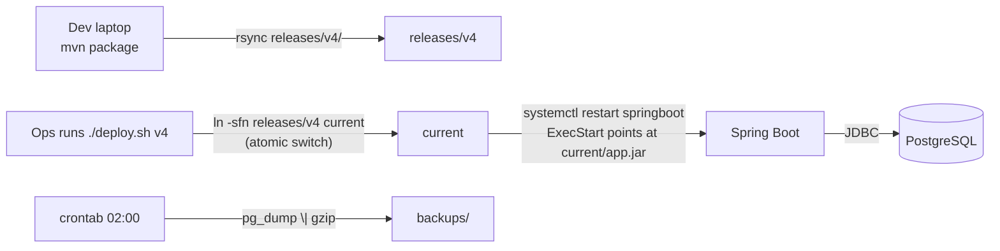

### Step-by-Step Lab

**Lab 3.1 — The releases folder convention & idempotent deploy.sh**

```bash
#!/usr/bin/env bash
set -euo pipefail   # conveyor belt safety: any broken step stops the whole line

APP_DIR=/opt/myapp
VERSION=${1:?usage: deploy.sh <version>}
mkdir -p "$APP_DIR/releases/$VERSION" "$APP_DIR/shared/logs"

# 1. Copy artifact (idempotent: rsync won't re-copy unchanged bytes)
rsync -av "/tmp/upload/app.jar" "$APP_DIR/releases/$VERSION/app.jar"

# 2. Atomic track switch
ln -sfn "$APP_DIR/releases/$VERSION" "$APP_DIR/current"

# 3. Restart via the building manager
sudo systemctl restart springboot
sudo systemctl is-active --quiet springboot && echo "DEPLOY OK: $VERSION"

# 4. Smoke test
curl -fsS http://localhost/api/health | grep -q '"UP"' && echo "SMOKE TEST PASSED"
```

| # | Command | Expected Output |
|---|---|---|
| 3.1.1 | `chmod +x deploy.sh && ./deploy.sh v2` | `DEPLOY OK: v2` + `SMOKE TEST PASSED`; `ls -l /opt/myapp/current` shows `-> releases/v2` |
| 3.1.2 | Run `./deploy.sh v2` **again** | Succeeds identically (idempotency proven — conveyor belt, not artisan craft). |
| 3.1.3 | `ls -l /opt/myapp/releases/` | v1, v2 both present — rollback runway exists. |
| 3.1.4 | `./rollback.sh` (=`ln -sfn releases/v1 current && systemctl restart springboot`) | `ROLLBACK OK: v1` |

**Lab 3.2 — logrotate (recycling program)**

```nginx
# /etc/logrotate.d/shop
/opt/myapp/shared/logs/*.log {
    weekly
    rotate 4
    compress
    missingok
    notifempty
    copytruncate
}
```
Validation: `sudo logrotate -d /etc/logrotate.d/shop` (dry run, `-d`) shows rotation plan; `sudo logrotate -f /etc/logrotate.d/shop` forces it; `ls /opt/myapp/shared/logs/` now shows `app.log.1.gz`.

**Lab 3.3 — Automated DB backups (the night guard)**

```bash
#!/usr/bin/env bash
# backup.sh — run by crontab at 02:00
TS=$(date +%Y%m%d-%H%M%S)
pg_dump -U shopuser -h localhost shopdb | gzip > /opt/myapp/shared/backups/shopdb-$TS.sql.gz
find /opt/myapp/shared/backups -name 'shopdb-*.sql.gz' -mtime +7 -delete
```
`crontab -e` → `0 2 * * * /opt/myapp/backup.sh >> /opt/myapp/shared/logs/backup.log 2>&1`. Validation: `crontab -l` lists the line; after simulated "next day," `ls /opt/myapp/shared/backups/` shows the new dump.

**Lab 3.4 — Disaster recovery drill (restore from photocopy)**

```bash
gunzip -c /opt/myapp/shared/backups/shopdb-20261123.sql.gz | psql -U shopuser -h localhost -d shopdb_restore
psql -U shopuser -h localhost -d shopdb_restore -c "SELECT COUNT(*) FROM orders;"
```
Validation: row count matches production `orders` count. MySQL track: `mysqldump -u shopuser -p shopdb > backup.sql` and `mysql -u shopuser -p shopdb_restore < backup.sql`.

## 3C. Chaos Labs

**Chaos 3.1 — "The Recycling Program Never Ran" (disk full)**

- **Symptom:** Deploy fails: `rsync: write failed — No space left on device`; `df -h` shows `/` at 100%; app may crash writing logs.
- **Imagine:** The factory's waste shelf overflowed because the recycling truck (logrotate) was never scheduled. New boxes can't be unloaded.
- **Diagnostic trail:** `df -h` → `/dev/vda1 100%` → `du -sh /opt/myapp/shared/logs/*` → one 38 GB `app.log` → `du -sh /opt/myapp/releases/*` → four old 200 MB releases.
- **Exact fix:** `sudo logrotate -f /etc/logrotate.d/shop`; delete oldest releases (`rm -rf releases/v1` after confirming current points to v3); add `maxsize 100M` + `daily` to logrotate config. Validate: `df -h` < 70%.

**Chaos 3.2 — "The Sign Points to a Demolished Track" (broken symlink)**

- **Symptom:** `systemctl status springboot` → `(code=exited, status=1)`; log: `Unable to access jarfile /opt/myapp/current/app.jar`.
- **Imagine:** Someone demolished old track v1 and repainted the ground — but the railroad sign still says "current → v1." The next train derails into a hole in the ground.
- **Diagnostic trail:** `ls -l /opt/myapp/current` → dangling red symlink → `ls /opt/myapp/releases/` → v1 was deleted.
- **Exact fix (rollback mindset):** `ln -sfn /opt/myapp/releases/v2 /opt/myapp/current && sudo systemctl restart springboot`. **Lesson:** never delete a release still referenced by `current` — deploy.sh must guard: `[[ "$(readlink current)" == *"$VERSION"* ]] || rm -rf` old releases only after smoke test passes.

**Chaos 3.3 — "The Stockroom Inventory Got Corrupted" (restore drill)**

- **Symptom:** `psql shopdb -c "SELECT * FROM orders;"` → `ERROR: could not read block ...` or a trainee ran `DROP TABLE orders;` — orders are gone.
- **Imagine:** A fire damaged tonight's stock, but last night's photocopy in the fireproof safe is intact.
- **Diagnostic trail:** Identify last good backup: `ls -lt /opt/myapp/shared/backups/ | head -3` → restore into a scratch DB first (never overwrite prod blindly!) → validate row counts → swap.
- **Exact fix:** `gunzip -c shopdb-...sql.gz | psql -U shopuser -d shopdb` (after `pg_dump` of the broken state to a `.corrupt` file for forensics). Validate: `SELECT COUNT(*)` matches backup manifest.

## 3D. Pain Point Table → unlocks Stage 4

| # | Pain | Root Cause | Why Stage 3 Still Isn't Enough |
|---|---|---|---|
| P3.1 | "Works on my laptop (Java 21 + glibc 2.35), crashes on server (Java 17 + glibc 2.31): `NoSuchMethodError` / `GLIBC_2.34 not found`." | Runtime environment = whatever is installed on that specific box. | No environment packaging. |
| P3.2 | Two apps on one server need *different* Java/Postgres versions → dependency hell. | Shared host OS is the unit of deployment. | No isolation. |
| P3.3 | "It runs on the server but I can't reproduce it locally" — new dev takes 2 days to set up. | Setup is tribal knowledge + wiki pages. | No portable, versioned environment. |
| P3.4 | Onboarding doc says "install Java, Postgres, Nginx, edit 4 configs" — every new machine is a snowflake. | Environment ≠ artifact. | No immutable infrastructure. |

---

# STAGE 4 — Containerization with Docker

## 4A. imagine_card: "The Standardized Shipping Container"

> **Imagine every kitchen in the world suddenly agreed to cook inside a *standardized steel shipping container*.**
> - Before containers, a chef arriving in Mumbai, London, or New York found a different stove, different gas fittings, different water pressure — the soup tasted different everywhere. That's your **JAR running on different Linux boxes**.
> - A **Docker image** is the *sealed container* carrying the chef AND the exact stove AND the exact gas fittings AND the recipe — soup tastes identical on any dock in the world. The **Dockerfile** is the *packing manual* describing exactly what goes into the box.
> - A **running container** is the *container sitting on the dock with the stove lit*.
> - **Named volumes** are the *dockside warehouse with its own address*: even if the container ship sinks (`docker rm`), the warehouse keeps your crates. Lose the warehouse link, and `docker rm` throws your crates into the ocean (this is Chaos 4.2).
> - **Port mapping** `-p 80:8080` is the *dock crane*: outside cranes reach the dock at door 80; inside, cargo is handed through the container's own door 8080.
> - **OOMKilled (exit 137)** is the *dock safety officer* who slams the container shut when the kitchen's gas usage exceeds the dock's fuel quota — the whole kitchen dies mid-service.

## 4B. architecture_flow

### Stage 4 Layout (ASCII)

```
  LEARNER LAPTOP                    DOCKER HOST (one VPS)
 ┌────────────────┐               ┌──────────────────────────────────────┐
 │ Dockerfile ────┼──▶ docker build│  ┌─────────────┐    ┌─────────────┐ │
 │ (packing manual)│   ───────────▶│  │  Container  │    │  Container  │ │
 │ .dockerignore   │    image shop │  │  shop-app   │    │  postgres   │ │
 └────────────────┘               │  │  :8080──┐   │    │  :5432      │ │
                                  │  └────┬────┘   │    └─────▲───────┘ │
                                  │       │ JDBC    │          │         │
                                  │       └─────────┼──────────┘         │
                                  │  bridge network: db reachable as     │
                                  │  container NAME "db" (not localhost!) │
                                  │  volume: pgdata ── survives docker rm │
                                  └──────────────────────────────────────┘
```

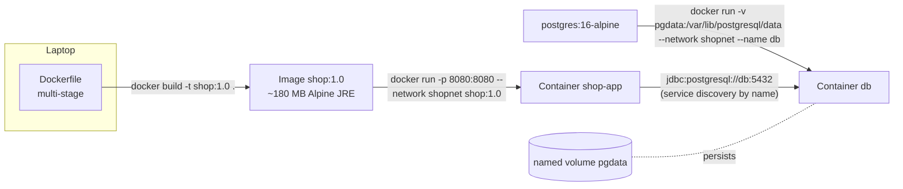

### Step-by-Step Lab

**Lab 4.1 — Multi-stage Dockerfile (packing manual)**

```dockerfile
# ---- Stage 1: the build kitchen (only needed to compile; thrown away after) ----
FROM maven:3.9-eclipse-temurin-17 AS builder
WORKDIR /build
COPY pom.xml .
RUN mvn dependency:go-offline          # cache layer trick: deps cached unless pom.xml changes
COPY src ./src
RUN mvn clean package -DskipTests

# ---- Stage 2: the shipping container (tiny, production-only) ----
FROM eclipse-temurin:17-jre-alpine
WORKDIR /app
RUN addgroup -S app && adduser -S app -G app
COPY --from=builder /build/target/*.jar app.jar
USER app
EXPOSE 8080
ENTRYPOINT ["java","-XX:+UseG1GC","-Xms256m","-Xmx768m","-jar","app.jar"]
```

`.dockerignore`: `target/`, `*.log`, `.git/`, `.idea/`

| # | Command | Expected Output |
|---|---|---|
| 4.1.1 | `docker build -t shop:1.0 .` | `naming to docker.io/library/shop:1.0 done` |
| 4.1.2 | `docker images` | `shop 1.0 ~190 MB` (vs builder stage ~700 MB — the packing manual threw the scaffolding away). |
| 4.1.3 | `docker history shop:1.0` | Layer list; `ADD file:...app.jar` near top. |
| 4.1.4 | `docker run -d --name shop-app -p 8080:8080 shop:1.0` | long container ID |
| 4.1.5 | `docker logs -f shop-app` | `Tomcat started on port 8080` |
| 4.1.6 | `docker exec -it shop-app sh` then `java -version` | `17.0.x` — **same everywhere, forever.** |
| 4.1.7 | `curl localhost:8080/api/health` | `{"status":"UP"}` |

**Lab 4.2 — Database in a container with a named volume**

| # | Command | Expected Output |
|---|---|---|
| 4.2.1 | `docker network create shopnet` | hash ID returned |
| 4.2.2 | `docker run -d --name db --network shopnet -v pgdata:/var/lib/postgresql/data -e POSTGRES_DB=shopdb -e POSTGRES_USER=shopuser -e POSTGRES_PASSWORD=ShopPass123! postgres:16-alpine` | container ID; `docker logs db` ends with `database system is ready to accept connections` |
| 4.2.3 | `docker run -d --name shop-app --network shopnet -p 8080:8080 -e DB_URL=jdbc:postgresql://db:5432/shopdb -e DB_USER=shopuser -e DB_PASSWORD=ShopPass123! shop:1.0` | app connects to host **`db`** by container name |
| 4.2.4 | `docker exec -it db psql -U shopuser -d shopdb -c "CREATE TABLE probe(id int); INSERT INTO probe VALUES (1);"` | `INSERT 0 1` |
| 4.2.5 | **Persistence proof:** `docker rm -f db` → re-run 4.2.2 with SAME volume → `docker exec -it db psql ... -c "SELECT * FROM probe;"` → `1` — *the warehouse kept the crates.* |

## 4C. Chaos Labs

**Chaos 4.1 — "The Dock Safety Officer Slams the Kitchen" (OOMKilled, exit 137)**

- **Symptom:** Container dies randomly under load; `docker ps -a` shows `Exited (137)`; logs end abruptly mid-request.
- **Imagine:** The kitchen's gas burners are rated for the menu — but someone ordered 5-course banquet service inside a container whose fuel line is capped at half capacity. The dock safety officer slams the whole kitchen shut mid-service. 137 = 128 + signal 9 (SIGKILL): the Linux kernel OOM-killer executed the container.
- **Diagnostic trail:** `docker inspect shop-app --format '{{.State.OOMKilled}}'` → `true` → `docker stats` replay shows memory pinned at limit → `docker inspect shop-app --format '{{.HostConfig.Memory}}'` → `536870912` (512 MB) → JVM was allowed `-Xmx768m`.
- **Exact fix:** Align the numbers: run with `-m 1g` OR drop JVM to `-Xmx512m` (always leave headroom for metaspace + threads + OS). Add `-XX:MaxRAMPercentage=75.0` as the professional habit. Validate: `docker stats` peak < 80% of limit; chaos-test passes.

**Chaos 4.2 — "The Crates Thrown Into the Ocean" (data lost on `docker rm`)**

- **Symptom:** After recreating the DB container, `SELECT * FROM probe;` → `ERROR: relation "probe" does not exist`. All data gone.
- **Imagine:** The container ship sank and took the unsold crates with it — because nobody rented dockside warehouse space. The warehouse (`-v pgdata:/var/lib/postgresql/data`) was never attached.
- **Diagnostic trail:** `docker inspect db --format '{{json .Mounts}}'` → `[]` (empty!). Compare with Chaos-proofed container showing `"pgdata"`.
- **Exact fix:** Recreate with `-v pgdata:/var/lib/postgresql/data`. **Lesson (burned in):** stateful containers without volumes = data on a bonfire. Validation: recreate twice, data persists.

**Chaos 4.3 — "The Kitchen Knocks on Its Own Container Wall" (the localhost trap)**

- **Symptom:** App container crashes: `Connection to localhost:5432 refused`. But `docker ps` shows the DB container healthy!
- **Imagine:** Each container is its **own private shipping container**. When the kitchen inside container A knocks on "localhost door 5432," it's knocking on *its own steel wall* — container B next door can't hear it. Containers reach each other by **dock address (container name on a shared network)**, not by "localhost."
- **Diagnostic trail:** `docker exec -it shop-app sh -c "nc -zv localhost 5432"` → refused → `docker exec -it shop-app sh -c "nc -zv db 5432"` → `open` (if on same network) → `docker network inspect shopnet` confirms both containers attached → env shows `DB_URL=jdbc:postgresql://localhost:5432/...`.
- **Exact fix:** `docker rm -f shop-app`, re-run with `-e DB_URL=jdbc:postgresql://db:5432/shopdb` on network `shopnet`. Validate: app log shows `HHH000... pool` + health UP.

## 4D. Pain Point Table → unlocks Stage 5

| # | Pain | Root Cause | Why Stage 4 Still Isn't Enough |
|---|---|---|---|
| P4.1 | Starting the full stack = remembering a 15-flag `docker run` incantation × 4 containers, in exact order, with exact names. | CLI flags are not declarative, not versioned, not reviewable. | No single source of truth for the stack. |
| P4.2 | App starts before DB finishes init → Hibernate crash → manual `docker restart shop-app` prayer. | No health-gated startup ordering. | No dependency orchestration. |
| P4.3 | `.env` secrets passed via `-e` flags visible in shell history & `ps aux`. | Ad-hoc flag passing. | Weak secret hygiene. |
| P4.4 | "Works on my machine" returns when a teammate forgets one flag. | Environment described orally, not in code. | No reproducible multi-container spec. |

---

# STAGE 5 — Multi-Container Orchestration with Docker Compose

## 5A. imagine_card: "The Conductor's Musical Score"

> **Imagine a full orchestra where the rhythm section (drums/bass = database), the strings (cache = Redis), and the lead singer (your Spring Boot app) must start in perfect order.**
> - **`docker-compose.yml`** is the *conductor's score*: one sheet of music every musician reads. The conductor (Compose) taps the rhythm section first, **waits until they're actually playing** (healthcheck: `pg_isready`), and only then raises the baton for the singer (app with `condition: service_healthy`). No more singers walking on stage before the drums are ready.
> - **Services** are the *musicians*; **networks** are the *stage layout* (front stage vs. backstage: `frontend` network carries public traffic to Nginx; `backend` network is backstage where app talks to DB — the audience can't walk backstage).
> - **`.env`** is the *locked drawer of personal sheet annotations*: passwords never appear in the shared score, only placeholders `${DB_PASSWORD}`.

## 5B. architecture_flow

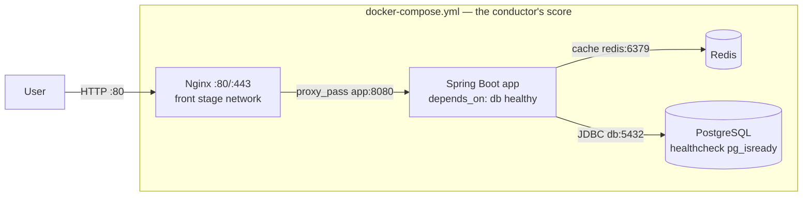

### Compose file (the canonical artifact for the whole stage)

```yaml
name: shop
services:
  nginx:
    image: nginx:1.27-alpine
    ports: ["80:80", "443:443"]
    volumes: ["./nginx/conf.d:/etc/nginx/conf.d:ro"]
    depends_on: [app]
    networks: [frontend]

  app:
    build: .
    environment:
      DB_URL: jdbc:postgresql://db:5432/shopdb
      DB_USER: shopuser
      DB_PASSWORD: ${DB_PASSWORD}
      REDIS_HOST: redis
    depends_on:
      db:
        condition: service_healthy
    networks: [frontend, backend]
    restart: unless-stopped

  db:
    image: postgres:16-alpine
    environment:
      POSTGRES_DB: shopdb
      POSTGRES_USER: shopuser
      POSTGRES_PASSWORD: ${DB_PASSWORD}
    volumes: [pgdata:/var/lib/postgresql/data]
    healthcheck:
      test: ["CMD-SHELL", "pg_isready -U shopuser -d shopdb"]
      interval: 5s
      timeout: 3s
      retries: 10
    networks: [backend]

  redis:
    image: redis:7-alpine
    networks: [backend]

volumes:
  pgdata:

networks:
  frontend:
  backend:
```

## 5B-bis. Step-by-Step Lab

| # | Command | Expected Output |
|---|---|---|
| 5.1.1 | `echo "DB_PASSWORD=ShopPass123!" > .env && chmod 600 .env` | file created |
| 5.1.2 | `docker compose config` (validates & renders the score) | YAML with `DB_PASSWORD: ShopPass123!` resolved; simulator rejects unresolvable vars |
| 5.1.3 | `docker compose up -d --build` | `Container shop-db-1 Healthy` appears BEFORE `shop-app-1 Started` — conductor's ordering proven live in the event stream |
| 5.1.4 | `docker compose ps` | all four services `running`/`healthy`; `db` shows `(healthy)` |
| 5.1.5 | `curl localhost/api/health` via Nginx | `{"status":"UP"}` |
| 5.1.6 | `docker compose logs -f app` | follow mode; Ctrl-C stops watching only |
| 5.1.7 | `docker compose exec db psql -U shopuser -d shopdb -c "SELECT 1;"` | `1` |
| 5.1.8 | `docker compose down && docker compose up -d` | **everything returns exactly** — the whole orchestra fits in one git repo |

## 5C. Chaos Labs

**Chaos 5.1 — "The Singer Walked On Before the Drums" (boot race)**

- **Symptom:** `docker compose up` sometimes leaves the app in `Restarting` or exited; logs: `Connection to db:5432 refused` (or MySQL: `Communications link failure`).
- **Imagine:** Without the conductor, the singer starts on beat 1 — but the drummer is still setting up his kit (Postgres init scripts run ~5–15 s on first boot). The song collapses; they restart and hope for luck.
- **Diagnostic trail:** `docker compose logs app | head -30` → JDBC refused → `docker compose ps` → db shows `(health: starting)` or `(unhealthy)` → note the absence of a healthcheck in the db service = `depends_on` without `condition` means "started," NOT "ready."
- **Exact fix:** Add the `healthcheck` block to `db` and change `depends_on` to `condition: service_healthy`; for the Spring Boot side, add Actuator and `management.endpoint.health.probes.enabled=true` so K8s-style probes exist later. Validate: `docker compose up` on a fresh volume shows deterministic healthy ordering 3/3 runs.

**Chaos 5.2 — "The Musician Moved Dressing Rooms" (network alias broken)**

- **Symptom:** App cannot resolve `db`: `UnknownHostException: db` or permanent JDBC timeout, yet `docker compose ps` shows DB healthy.
- **Imagine:** The drummer is playing in dressing room 3, but the singer's lyric sheet still says "dressing room 2." Same theater, wrong room number. Compose creates a DNS name per service — but if the app was pointed at a custom alias or an old compose project name (`docker compose -p oldname up`), names drift.
- **Diagnostic trail:** `docker compose exec app getent hosts db` → empty → `docker network inspect shop_backend` → db container's actual name is `shop-db-1` but network aliases list only `db` within project → check `DB_URL` env: `docker compose exec app env | grep DB_URL`.
- **Exact fix:** `DB_URL=jdbc:postgresql://db:5432/shopdb` (service name, on the shared `backend` network). Validate: `getent hosts db` returns an IP; health UP.

**Chaos 5.3 — "The Placeholder That Wasn't" (unexpanded `${DB_PASSWORD}`)**

- **Symptom:** DB logs: `FATAL: password authentication failed for user "shopuser"` — even though the password is "correct."
- **Imagine:** The singer's lyric sheet literally contains the words "*the password goes here*" — someone sang the stage direction out loud. The literal string `${DB_PASSWORD}` became the actual password for one service (or for the DB but not the app).
- **Diagnostic trail:** `docker compose config | grep -i password` → some services show resolved value, one shows literal `${DB_PASSWORD}` → `docker compose exec db env | grep POSTGRES_PASSWORD` shows the literal → root cause: `.env` file missing/renamed (or shell variable unset with `docker compose` not reading it).
- **Exact fix:** Recreate `.env` in the same directory as `docker-compose.yml`; `docker compose config` to verify rendering; `docker compose up -d --force-recreate db app`. Validate: login succeeds.

## 5D. Pain Point Table → unlocks Stage 6

| # | Pain | Root Cause | Why Stage 5 Still Isn't Enough |
|---|---|---|---|
| P5.1 | One VPS = single point of failure. Host dies → entire orchestra silenced. | One machine. | Need multi-host/cloud. |
| P5.2 | Traffic spikes 10× during a flash sale; the single host saturates CPU/disk. | Vertical-only scaling. | Need elastic capacity + load balancing. |
| P5.3 | Self-managed Postgres: patching, replication, backups, failover all on you. | You are the DBA on call. | Need managed DB service. |
| P5.4 | Secrets in `.env` on disk; firewall rules manual; no audit trail of who opened what port. | Home-grown security. | Need cloud IAM/security groups. |

---
# STAGE 6 — Cloud Infrastructure & Managed Services (AWS-Style Architecture)

## 6A. imagine_card: "Moving Into the Gated Smart City"

> **Imagine your factory moves out of its standalone shed into a *gated smart-city industrial park*.**
> - The **VPC (Virtual Private Cloud)** is the *walled city*: your own private road network inside a giant metropolis. Nobody outside the walls sees your trucks.
> - **Public subnets** are the *showrooms on Main Street* — the only buildings with doors facing the outside world. **Private subnets** are the *factories deep inside the city* — no outside door at all; every delivery comes through the city's own gate system.
> - **Security Groups** are *bouncers with guest lists chained together*: the gate bouncer (ALB/Load Balancer) allows `80/443` from anywhere; he passes visitors only to the showroom bouncer (App SG), who accepts *only* the gate bouncer; the warehouse bouncer (RDS SG) accepts *only* the showroom bouncer on port 5432. No direct path from street to warehouse — ever.
> - **Managed RDS (PostgreSQL/MySQL)** is the *city-run bonded warehouse*: professional guards handle inventory safety (automated backups, patching, failover). You rent shelf space; you never fix the roof.
> - **S3** is the *city's infinite document vault* for files (uploads, invoices) with signed, expiring visitor passes (presigned URLs / bucket policies).
> - **HikariCP connection pool** is the *fleet of delivery scooters* between showroom and warehouse: if all scooters are checked out and never returned (connection leak), new orders wait 30 s and die — `Connection is not available, request timed out after 30000ms`.

## 6B. architecture_flow

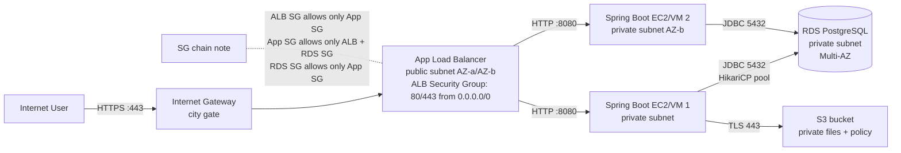

### Step-by-Step Lab

**Lab 6.1 — Network topology build (drag-and-drop cloud console simulator)**

| # | Action (simulator) | Validation |
|---|---|---|
| 6.1.1 | Create VPC `10.20.0.0/16` | VPC exists, DNS hostnames enabled |
| 6.1.2 | Create public subnets `10.20.1.0/24` (AZ-a), `10.20.2.0/24` (AZ-b) + Internet Gateway + route table `0.0.0.0/0 → igw` | Subnets show `MapPublicIpOnLaunch = true` |
| 6.1.3 | Create private subnets `10.20.11.0/24`, `10.20.12.0/24` for app; `10.20.21.0/24`, `10.20.22.0/24` for RDS; NAT Gateway in public subnet | Private route table sends `0.0.0.0/0 → nat` (outbound updates only) |
| 6.1.4 | Create Security Groups (chained guest lists): `sg-alb` (in: 443 from `0.0.0.0/0`; out: all) → `sg-app` (in: 8080 **source sg-alb only**; out: all) → `sg-rds` (in: 5432 **source sg-app only**) | `sg-rds` has **no** entry for `0.0.0.0/0` — simulator quiz gate: "Who may knock on the warehouse door?" |
| 6.1.5 | Launch two app instances in private subnets (user-data pulls the Stage-5 image from a registry); verify **no public IP** | Topology map shows app nodes in private zone, reachable only via ALB |
| 6.1.6 | Create RDS PostgreSQL `db.t3.medium`, Multi-AZ, storage encrypted, in `10.20.21.0/24`, SG = `sg-rds` | Endpoint like `shop-db.xxxx.ap-south-1.rds.amazonaws.com:5432` |

**Lab 6.2 — HikariCP tuning against a managed database**

```properties
spring.datasource.url=jdbc:postgresql://shop-db.xxxx.ap-south-1.rds.amazonaws.com:5432/shopdb
spring.datasource.hikari.maximum-pool-size=10
spring.datasource.hikari.minimum-idle=3
spring.datasource.hikari.connection-timeout=30000
spring.datasource.hikari.idle-timeout=600000
spring.datasource.hikari.max-lifetime=1700000
spring.datasource.hikari.leak-detection-threshold=60000
```

Rule of thumb table:

| RDS max_connections | app instances | Hikari maximum-pool-size per instance |
|---|---|---|
| 100 | 2 | 10 each (leave headroom for admin/monitoring) |

**Lab 6.3 — S3 file upload path**

App uses presigned URLs: backend signs a PUT URL (15 min expiry) → browser uploads directly to S3. Validation: bucket policy denies all except TLS + the app's IAM role; uploaded object has `ServerSideEncryption: aws:kms`.

## 6C. Chaos Labs

**Chaos 6.1 — "The Warehouse Bouncer Lost the Guest List" (Security Group blocks 5432)**

- **Symptom:** Both app instances log `Connection timed out` (not refused — *timed out*, the signature of a silent firewall drop) to the RDS endpoint.
- **Imagine:** The bonded warehouse's bouncer has a guest list, but someone printed last week's version — your showroom's new scooters aren't on it, so they're simply ignored at the door. (Refused = door slammed; timeout = door never answered.)
- **Diagnostic trail:** From app instance: `nc -zv shop-db.xxxx.rds.amazonaws.com 5432` → timeout → `dig +short` resolves correctly (DNS fine) → console/RDS SG inbound rules: no 5432 from `sg-app`, or wrong SG reference (peering/VPC mismatch).
- **Exact fix:** Add inbound rule `PostgreSQL (5432) | source: sg-app` to `sg-rds`. Validate: `nc -zv` → `succeeded`; Hikari pool initializes (`HikariPool-1 - Start completed`).

**Chaos 6.2 — "All Scooters Checked Out, None Returned" (HikariCP pool exhaustion)**

- **Symptom:** Under load, API errors: `HikariPool-1 - Connection is not available, request timed out after 30000ms`; CPU is normal, DB CPU normal — yet requests fail.
- **Imagine:** Your showroom has 10 delivery scooters. Staff keep checking them out for "quick errands" and parking them in personal garages (connections acquired but never closed — a missing `try-with-resources` in one repository method). New orders wait at the counter; after 30 s they leave angry.
- **Diagnostic trail:** `curl actuator`: `hikaricp.connections.active` pinned at 10 while `pending` grows → `leak-detection-threshold` fires in logs: `Connection leak detection triggered ... stacktrace` → the stacktrace points to `OrderRepository.findOpenOrders` (missing `try (Connection c = ds.getConnection())`).
- **Exact fix:** Fix the leak (try-with-resources / `@Transactional` boundaries), restart instances. Validate: `hikaricp.connections.active` returns toward `minimum-idle` between request bursts; chaos load test passes.

**Chaos 6.3 — "One Showroom Burned Down; Visitors Get Turned Away at the Door" (AZ failure without health checks)**

- **Symptom:** ALB returns 502 for ~50% of requests; one AZ's instance is dead after a simulated AZ failure.
- **Imagine:** The smart city has two showrooms; one caught fire. But the gatekeeper keeps sending every other visitor to the burned showroom because nobody told him it's gone.
- **Diagnostic trail:** ALB target group shows 1/2 targets `unhealthy` → app instance failed AZ-failure chaos injection → ALB health check path `/actuator/health` returning 404 (app has no actuator!).
- **Exact fix:** Add Spring Actuator, set ALB health check to `/actuator/health`, `healthy_threshold=2`, `interval=15s`. Validate: after killing one instance, ALB drains and routes 100% to the survivor (target group 1/1 healthy).

## 6D. Pain Point Table → unlocks Stage 7

| # | Pain | Root Cause | Why Stage 6 Still Isn't Enough |
|---|---|---|---|
| P6.1 | Deploy = SSH into instances, `docker pull`, `docker run` by hand on each. Human-managed fleet. | No automation from git to running container. | Need CI/CD. |
| P6.2 | A developer's broken commit ships to production at 6 PM Friday; discovered by users. | No automated tests/security scans gating deploys. | Need pipeline quality gates. |
| P6.3 | "Which version is actually running in prod?" — nobody knows; images tagged `latest` everywhere. | No immutable, traceable artifact tagging. | Need Git-SHA tagging & pipeline provenance. |
| P6.4 | Rollback = SSH in, guess which old image, pray. | No automated rollback on failed health checks. | Need deploy automation with smoke-test rollback. |

---

# STAGE 7 — Full CI/CD Pipelines (GitHub Actions)

## 7A. imagine_card: "The Automated Airport Security & Baggage System"

> **Imagine your code is luggage, and every `git push` sends a suitcase to the airport.**
> - **The pipeline (GitHub Actions)** is the *automated baggage conveyor with X-ray scanners*: every suitcase passes through the scanners in order — **Unit Tests X-ray** (does the suitcase contain what it claims?), **Testcontainers Explosive Trace Detection** (does it really work against a real PostgreSQL?), **Security Scanner** (Trivy/Snyk: any dangerous items?), and only then is it *loaded onto the aircraft* (deployed to production).
> - **Git SHA tagging** (`shop:1.0.0-a1b2c3d`) is the *baggage tag*: every suitcase has a unique, unforgeable tag. Never tag a suitcase "the latest one" — that's how bags get lost (the `:latest` trap).
> - **GitHub Secrets** are the *airport's locked key cabinet*: the conveyor needs the production server's key (SSH private key, registry token), but those keys never appear on passenger-visible luggage tags (never in logs, never in the YAML as plaintext).
> - **The smoke test + auto-rollback** is the *final gate agent who opens the suitcase at the destination*: if the contents are broken (health check fails), the suitcase is immediately sent back on the return flight (`docker rollout undo` / previous task restored) — passengers never see the broken bag.

## 7B. architecture_flow

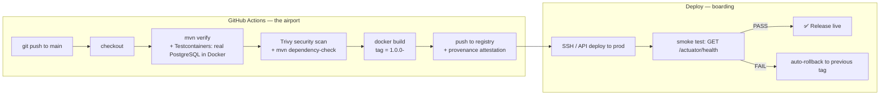

### Pipeline YAML (canonical artifact)

```yaml
name: deploy
on:
  push: { branches: [main] }
env:
  IMAGE: registry.example.com/shop
jobs:
  test:
    runs-on: ubuntu-latest
    steps:
      - uses: actions/checkout@v4
      - uses: actions/setup-java@v4
        with: { distribution: temurin, java-version: '17', cache: maven }
      - name: Unit + integration tests (Testcontainers spins real PostgreSQL)
        run: mvn -B verify
      - name: Security scan
        run: |
          docker run --rm -v "$PWD":/repo aquasec/trivy fs --exit-code 1 --severity HIGH,CRITICAL /repo
  build:
    needs: test
    runs-on: ubuntu-latest
    outputs: { tag: steps.meta.outputs.tag }
    steps:
      - uses: actions/checkout@v4
      - id: meta
        run: echo "tag=1.0.0-$(git rev-parse --short HEAD)" >> "$GITHUB_OUTPUT"
      - uses: docker/login-action@v3
        with:
          registry: registry.example.com
          username: ${{ secrets.REGISTRY_USER }}
          password: ${{ secrets.REGISTRY_TOKEN }}
      - run: |
          docker build -t "$IMAGE:${{ steps.meta.outputs.tag }}" .
          docker push "$IMAGE:${{ steps.meta.outputs.tag }}"
  deploy:
    needs: build
    runs-on: ubuntu-latest
    environment: production
    steps:
      - name: Rolling deploy over SSH
        uses: appleboy/ssh-action@v1
        with:
          host: ${{ secrets.PROD_HOST }}
          username: deploy
          key: ${{ secrets.PROD_SSH_KEY }}
          script: |
            set -e
            docker pull "$IMAGE:${{ needs.build.outputs.tag }}"
            docker compose up -d app   # compose file references the pinned tag
      - name: Smoke test + auto-rollback
        run: |
          for i in 1 2 3 4 5; do
            curl -fsS https://shop.example.com/actuator/health && exit 0
            sleep 10
          done
          echo "SMOKE TEST FAILED — rolling back"
          ssh deploy@${{ secrets.PROD_HOST }} "docker compose up -d app  # points at previous tag"
          exit 1
```

### Step-by-Step Lab

| # | Action | Expected Output |
|---|---|---|
| 7.1.1 | Add a deliberately failing test (`assertTrue(false)`) and push | Pipeline fails at `mvn verify` with ❌; **deploy never runs** — the X-ray stopped the bag |
| 7.1.2 | Remove the failing test, push | Green ✅ through build+push; GitHub Packages/registry shows tag `1.0.0-a1b2c3d` |
| 7.1.3 | Simulator: view the deploy run — SSH step output | Server pulled exactly `1.0.0-a1b2c3d`, smoke test `{"status":"UP"}` ✅ |
| 7.1.4 | `curl https://shop.example.com/actuator/info` | Shows `git.sha=a1b2c3d` — provable traceability from prod back to code |
| 7.1.5 | Push a commit that breaks the health endpoint (returns 503) | Smoke test fails → pipeline shows auto-rollback step → prod serves previous tag (verified via `/actuator/info`) |

## 7C. Chaos Labs

**Chaos 7.1 — "The Key Cabinet Was Empty" (missing GitHub Secrets)**

- **Symptom:** Pipeline fails at `docker/login-action` with `Error: Username and password required` or SSH step `Error: can't connect without a private key`.
- **Imagine:** The baggage conveyor reached the loading dock, but the dock crew found the key cabinet empty — nobody stocked the production server's key into the airport's locked cabinet (GitHub Secrets).
- **Diagnostic trail:** Workflow log pinpointed to the failing step → Settings → Secrets and variables → Actions: `REGISTRY_TOKEN` missing/empty, or `PROD_SSH_KEY` never added.
- **Exact fix:** Add secrets `REGISTRY_USER`, `REGISTRY_TOKEN`, `PROD_HOST`, `PROD_SSH_KEY` (private key paste), re-run job. Validate: green pipeline. **Lesson:** secrets live in GitHub, never in YAML; `${{ secrets.X }}` is redacted in logs even if echoed.

**Chaos 7.2 — "The 'Latest' Bag Mix-Up" (stale `:latest` tag)**

- **Symptom:** New code pushed, pipeline green, but production still serves old behavior; `/actuator/info` shows an old SHA.
- **Imagine:** Every suitcase is labeled "the latest one." The loading crew grabs *a* bag labeled "latest" — which happens to be an old one still on the shelf because nobody cleaned the shelf (registry cache / node-cached image).
- **Diagnostic trail:** Server: `docker compose config | grep image` → `image: registry.../shop:latest` ← the bug: mutable tag → `docker images` shows `latest` created 3 weeks ago; compose sees tag already present and doesn't pull.
- **Exact fix:** Pin immutable tags (`1.0.0-a1b2c3d`) via pipeline output into the server's compose `.env` (`IMAGE_TAG=...`) then `docker compose pull && up -d`. Add `pull_policy: always`. Validate: new SHA live within 2 min of push.

**Chaos 7.3 — "The Gate Agent Caught a Broken Bag" (failed smoke test → rollback)**

- **Symptom:** Deploy job goes red at "Smoke test + auto-rollback"; prod stays on the previous version; alert fires.
- **Imagine:** The final gate agent opened the suitcase at the destination: the health certificate inside was blank (endpoint 503). The bag never entered the cabin — it went back on the return flight automatically.
- **Diagnostic trail:** Workflow shows `SMOKE TEST FAILED — rolling back` → SSH rollback command output: `Recreating shop-app-1 ... done` → `/actuator/info` still previous SHA → **why did health fail?** Read `docker compose logs app` on server via a diagnostic step: NPE in new `PromoController`.
- **Exact fix:** Learner fixes the bug, pushes again → new SHA deploys green. The lesson: **rollback is not shameful — it's the safety net that makes deploys boring.**

## 7D. Pain Point Table → unlocks Stage 8

| # | Pain | Root Cause | Why Stage 7 Still Isn't Enough |
|---|---|---|---|
| P7.1 | Rolling deploys on fixed VM counts take minutes; can't shift capacity per service (DB vs app vs cache). | VM-scoped scaling, coarse granularity. | Need pod-level scheduling. |
| P7.2 | No canary: 100% of users get the new version the instant it deploys. | All-or-nothing deploys. | Need progressive delivery (canary/blue-green at traffic level). |
| P7.3 | Server dies at night → pager duty → manual `docker compose up` on a new VM. | Self-healing is human-powered. | Need automatic rescheduling. |
| P7.4 | Config/secrets per environment managed via SSH'd `.env` files drifting apart. | Imperative, per-host config. | Need declarative, cluster-level config objects. |

---

# STAGE 8 — Kubernetes (K8s) Production Orchestration

## 8A. imagine_card: "The Autonomous Fleet Commander"

> **Imagine your app is now a *fleet of cargo ships*, and Kubernetes is the *autonomous fleet command center*.**
> - **Deployment / desired state:** You radio the commander: "*exactly 3 ships must be sailing the Mumbai route, carrying manifest v9.*" The commander continuously counts ships. One sinks (node failure)? A replacement is launched automatically. Two extra appear (accident)? They're decommissioned. You never steer — you *declare*, the commander *enforces* (control loop).
> - **Pod** = one ship (the smallest unit; a wrapper around your container(s)). **Service** = the fleet's *harbor address* ("Mumbai Route 1") — customers address the route, not individual ships; if a ship is replaced, the harbor address never changes (stable virtual IP + DNS).
> - **Ingress** = the *international port authority*: one harbor gate (443) routing "ships carrying /api/orders" to the right route, with TLS certificates at the gate.
> - **ConfigMap** = the *posted sailing notice board* (non-secret config). **Secret** = the *captain's sealed orders envelope* (base64-obfuscated, mounted into ships).
> - **StatefulSet + PVC** = the *warehouse fleet*: warehouses need stable identity ("Warehouse Mumbai-1" keeps its name and lease) and permanent dock space (**PersistentVolumeClaim**) — unlike cargo ships, warehouses can't be freely swapped.
> - **Probes**: *Readiness* = harbor inspector verifying "this ship is loaded and may accept cargo" (traffic only flows to ready ships); *Liveness* = coast-guard patrol that **scuttles and replaces** a ship that's drifting unresponsive; *Startup* = a long grace timer for slow, heavy ships — a Spring Boot JVM can take 60–120 s to warm up, and the coast guard must not scuttle a ship that's still being loaded. (Killing a slow-starting Spring Boot pod mid-boot is Chaos 8.4.)
> - **HPA (Horizontal Pod Autoscaler)** = *reinforcement command*: when holiday traffic floods the route, the commander radios for more ships (scale 3 → 10) and decommissions them after the rush.

## 8B. architecture_flow

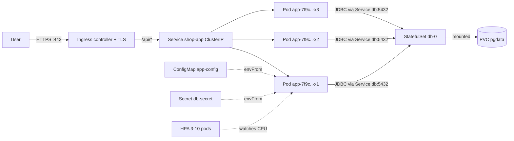

### Canonical manifests (learning artifacts)

```yaml
apiVersion: apps/v1
kind: Deployment
metadata: { name: shop-app, labels: { app: shop-app } }
spec:
  replicas: 3
  selector: { matchLabels: { app: shop-app } }
  template:
    metadata: { labels: { app: shop-app } }
    spec:
      containers:
        - name: app
          image: registry.example.com/shop:1.0.0-a1b2c3d   # immutable tag, always
          ports: [{ containerPort: 8080 }]
          envFrom:
            - configMapRef: { name: shop-config }
            - secretRef: { name: shop-secret }
          resources:
            requests: { cpu: 250m, memory: 512Mi }   # scheduling contract
            limits:   { cpu: "1",  memory: 768Mi }
          startupProbe:
            httpGet: { path: /actuator/health/liveness, port: 8080 }
            failureThreshold: 30      # 30 × 10s = 5 min grace for slow JVM boot
            periodSeconds: 10
          readinessProbe:
            httpGet: { path: /actuator/health/readiness, port: 8080 }
            periodSeconds: 5
          livenessProbe:
            httpGet: { path: /actuator/health/liveness, port: 8080 }
            periodSeconds: 10
            failureThreshold: 3
---
apiVersion: v1
kind: Service
metadata: { name: shop-app }
spec:
  selector: { app: shop-app }
  ports: [{ port: 80, targetPort: 8080 }]
  type: ClusterIP
---
apiVersion: apps/v1
kind: StatefulSet
metadata: { name: db }
spec:
  serviceName: db
  replicas: 1
  selector: { matchLabels: { app: db } }
  template:
    metadata: { labels: { app: db } }
    spec:
      containers:
        - name: postgres
          image: postgres:16-alpine
          envFrom: [{ secretRef: { name: shop-secret } }]
          volumeMounts: [{ name: pgdata, mountPath: /var/lib/postgresql/data }]
  volumeClaimTemplates:
    - metadata: { name: pgdata }
      spec:
        accessModes: [ReadWriteOnce]
        resources: { requests: { storage: 10Gi } }
---
apiVersion: v1
kind: Secret
metadata: { name: shop-secret }
type: Opaque
stringData:
  POSTGRES_PASSWORD: ShopPass123!
---
apiVersion: autoscaling/v2
kind: HorizontalPodAutoscaler
metadata: { name: shop-app }
spec:
  scaleTargetRef: { apiVersion: apps/v1, kind: Deployment, name: shop-app }
  minReplicas: 3
  maxReplicas: 10
  metrics: [{ type: Resource, resource: { name: cpu, target: { type: Utilization, averageUtilization: 70 } } }]
```

### Step-by-Step Lab

| # | Command | Expected Output |
|---|---|---|
| 8.1.1 | `kubectl apply -f k8s/` | `deployment.apps/shop-app created`, `statefulset.apps/db created`, etc. |
| 8.1.2 | `kubectl get pods -w` | `db-0` 0/1 → 1/1 Running; then app pods `ContainerCreating → Running` (conductor ordering via init/containers + probes) |
| 8.1.3 | `kubectl describe pod shop-app-xxxxx` | Events: `Scheduled`, `Pulled`, `Created`, `Started`, then `probe warning` if slow — learner watches probe timeline live |
| 8.1.4 | `kubectl get svc` | `shop-app ClusterIP 10.96.x.x`, `db ClusterIP None (headless)` |
| 8.1.5 | `kubectl port-forward svc/shop-app 8080:80` + `curl localhost:8080/api/orders` | JSON — first request through a Service! |
| 8.1.6 | `kubectl apply -f k8s/ingress.yaml` + `curl -k https://shop.localtest.me/api/health` | `{"status":"UP"}` through Ingress+TLS |
| 8.1.7 | **The magic moment:** `kubectl delete pod shop-app-xxxxx` then `kubectl get pods -w` | A new pod spawns automatically in seconds; `curl` to the Service never fails — *the commander replaced the sunken ship mid-voyage.* |
| 8.1.8 | `kubectl rollout status deployment/shop-app` then deploy v2 (`kubectl apply` with new image tag) | `Waiting for deployment "shop-app" rollout to finish: 2 of 3 updated...` → success — rolling update, zero downtime |
| 8.1.9 | `kubectl rollout undo deployment/shop-app` | instantly back to previous ReplicaSet — *the return flight* |
| 8.1.10 | `kubectl top pods` + HPA: `kubectl get hpa -w` while chaos-load runs | `shop-app   Deployment/shop-app   175%/70%   3 → 7 pods` — reinforcements arrived |

## 8C. Chaos Labs

**Chaos 8.1 — "Sealed Orders With a Misspelled Word" (Secret key typo → CrashLoopBackOff)**

- **Symptom:** Pods flip `CrashLoopBackOff`; `kubectl logs` shows `IllegalStateException: Required key 'DB_PASSWORD' not found` (or Postgres: `FATAL: password authentication failed`).
- **Imagine:** The captain opened his sealed orders envelope and found `DB_PASSW0RD` (with a zero) — the radio operator's typo means the envelope doesn't contain the word the ship's manifest demands.
- **Diagnostic trail:** `kubectl get pods` → `RESTARTS 5 (CrashLoopBackOff)` → `kubectl describe pod shop-app-xx` → Last State: Error, exit 1 → `kubectl logs shop-app-xx --previous` → exact missing/typo key → `kubectl get secret shop-secret -o yaml` → key listed as `DB_PASSW0RD`.
- **Exact fix:** `kubectl patch secret shop-secret ...` or re-apply corrected Secret manifest; `kubectl rollout restart deployment/shop-app`. Validate: pods Running, restarts stable at 0.

**Chaos 8.2 — "The Ship's Name Isn't in the Harbor Registry" (ImagePullBackOff)**

- **Symptom:** Pods stuck `ImagePullBackOff`; describe shows `Failed to pull image ... not found` (or `pull access denied`).
- **Imagine:** The commander radioed for ship "SS Shop v1.0.9-private" but that name doesn't exist in the harbor registry — the crew typed the tag wrong, or the image is private and the ship lacks harbor credentials (`imagePullSecrets`).
- **Diagnostic trail:** `kubectl describe pod` → Events: `ErrImagePull` → `Back-off pulling image "registry.../shop:1.0.9-wrongtag"` → verify tag exists: `docker manifest inspect registry.../shop:1.0.9` from CI.
- **Exact fix:** Correct the image tag in the Deployment (immutability wins again) or add `imagePullSecrets` for private registries. Validate: `kubectl get pods` Running.

**Chaos 8.3 — "The Commander Has No Dock Space" (Pending pod — resources/PVC)**

- **Symptom:** `kubectl get pods` shows `shop-app-xxx Pending` (or `db-0 Pending`) forever.
- **Imagine:** The commander wants to launch 3 ships but the harbor has only 2 free docks, and the 3rd ship's lease request (`requests: cpu 250m`) can't be honored. For the warehouse: the dock itself hasn't been built yet — the PVC can't find a matching PersistentVolume (storage class misconfigured) so `db-0` never starts.
- **Diagnostic trail:** `kubectl describe pod shop-app-xxx` → Events: `Insufficient cpu (3 nodes: insufficient memory/cpu...)` OR for db: `FailedScheduling ... pod has unbound immediate PersistentVolumeClaims` → `kubectl get pvc` → `Pending`.
- **Exact fix:** Right-size requests (drop to `cpu: 100m`), add a node (simulator "scale cluster"), or fix `storageClassName` in the PVC and ensure the provisioner exists. Validate: scheduling event `Successfully assigned default/shop-app-xxx to node-2`.

**Chaos 8.4 — "The Coast Guard Scuttled a Ship Still Being Loaded" (liveness kills slow Spring Boot)**

- **Symptom:** Pods restart every ~90 s; logs show JVM *starting* (Hibernate init) then truncated; never reaches "Started Application".
- **Imagine:** A heavy cargo ship needs 3 minutes to load fuel and cargo before departure. The coast-guard patrol, checking every 30 seconds whether the ship has left port, concludes "drifting unresponsive" and **scuttles a ship that was 80% loaded** — the replacement ship meets the same fate. Infinite loop of murdered ships.
- **Diagnostic trail:** `kubectl get pods` → restarts climbing, `READY 0/1` → `kubectl describe pod` → `Liveness probe failed: Get "http://:8080/actuator/health" connection refused` → timestamps show restart at ~90 s while app log shows boot needs ~110 s → livenessProbe had `initialDelaySeconds: 30, failureThreshold: 2, periodSeconds: 30` → death at ~90 s.
- **Exact fix (the professional pattern):** Replace initialDelay guessing with a **startupProbe** (`failureThreshold: 30 × periodSeconds 10` = 5 min grace). Liveness only activates *after* startup succeeds. Validate: pod boots fully, `Started Application in 112 seconds`, then `READY 1/1` and stays up.

## 8D. Pain Point Table → Course Summit

| # | Pain | Root Cause | Resolution (Course Capstone) |
|---|---|---|---|
| P8.1 | Single cluster still hand-applied (`kubectl apply` from laptops). | No GitOps. | Capstone 10: ArgoCD GitOps + multi-env. |
| P8.2 | Secrets in plain YAML in git. | No sealed/externally-managed secrets. | External Secrets Operator / Sealed Secrets. |
| P8.3 | No traffic splitting for risky releases. | No service-mesh/ingress canary. | Ingress canary annotations (Capstone 9/10). |
| P8.4 | Observability gaps: pods restart silently. | No centralized logs/metrics/alerts. | Prometheus + Grafana + Alertmanager (Capstone 8+). |

---
# REFERENCE SECTION 1 — The Ultimate DevOps & Spring Boot Command Encyclopedia

Organized as: `Command` | `Plain-English Meaning` | `Real-World Spring Boot/DB Example` | `Pro-Tip / Trap to Avoid`.

## 1.1 Linux Navigation, Permissions & Diagnostics

| Command | Plain-English Meaning | Spring Boot/DB Example | Pro-Tip / Trap |
|---|---|---|---|
| `pwd` | "Where am I standing right now?" | `pwd` → `/opt/myapp` | Nothing. |
| `ls -lh` | "List the files in this room with human sizes." | `ls -lh target/*.jar` → `app.jar 41M` | `-h` shows MB/GB; without it you count bytes. |
| `cd /opt/myapp` | "Walk into the workshop." | `cd /opt/myapp/releases/v3` | `cd -` jumps back to previous room. |
| `mkdir -p releases/v2` | "Build nested shelves, and don't complain if they exist." | Create release folders in deploy.sh | `-p` = idempotent = safe in scripts. |
| `cp app.jar releases/v2/` | "Photocopy a file." | Copy artifact into version folder | Use `rsync` for big copies (resumes). |
| `mv current newname` | "Carry a box to a new address (same building)." | Atomic symlink rename trick | `mv` within a filesystem = instant; across disks = slow copy. |
| `rm -rf releases/v1` | "Shred this folder and everything inside. No undo." | Cleanup after smoke test passes | **Trap:** never `rm -rf` a release `current` still points to. |
| `chmod 400 deploy.pem` | "Only the owner may read this key; everyone else: hands off." | Fix SSH "permissions too open" | 4=read, 2=write, 1=execute. 400 = r--------. |
| `chmod +x deploy.sh` | "This document is now a program you can run." | After writing deploy.sh | Without it: `Permission denied`. |
| `chown app:app app.jar` | "Hand ownership of this box's contents to the app user." | Non-root container file perms | Least privilege: the app user shouldn't own system files. |
| `ps aux \| grep java` | "Show every process; filter only Java ones." | Find the JVM's PID before `kill` | `pgrep -f app.jar` is the shorter pro form. |
| `kill 2142` / `kill -9 2142` | "Politely ask process 2142 to stop" / "Sledgehammer it." | Stop old JAR before redeploy | Always try plain `kill` first; `-9` skips cleanup (DB connections left hanging). |
| `top` / `htop` | "Live dashboard of who is eating CPU/RAM." | Spot the runaway JVM at 198% CPU | `htop` is interactive; press `F6` to sort. |
| `free -h` | "How much RAM is free, human-readable?" | Check if the box can even host the JVM | Linux "uses" spare RAM for cache — watch `available`, not `free`. |
| `df -h` | "How full is each disk?" | Diagnose `No space left on device` | 100% on `/` = logs or releases are the usual suspects. |
| `du -sh /opt/myapp/*` | "How big is each shelf?" (folder sizes) | Find the 38 GB `app.log` | `du -xh --max-depth=1 / \| sort -h` finds disk hogs fast. |
| `ss -tlnp` | "Which doors are open, who's listening, with process names?" | Confirm Java on 8080, Postgres on 5432 | `t`=TCP `l`=listen `n`=numeric `p`=process. Refused vs timeout diagnosis starts here. |
| `lsof -i :8080` | "Who is using door 8080?" | Find PID to kill in `BindException` | Add `+D /opt` to find which process holds a file open. |
| `tail -f app.log` | "Sit and watch the end of the logbook as it's written." | Watch Spring Boot startup | Ctrl-C stops *you watching*; the app keeps running. |
| `tail -n 200 app.log` | "Show me just the last 200 lines." | Grab the crash lines without flooding | `-f -n 200` combines both. |
| `grep -i "error" app.log` | "Find lines mentioning error (case-insensitive)." | Hunt `Connection refused` in logs | `-C 5` shows 5 lines of context around each hit. |
| `journalctl -u springboot -f` | "The building manager's logbook, live." | systemd service debugging | `--since "1 hour ago"` zooms the time window. |
| `systemctl status springboot` | "Is the building manager's employee at his desk?" | First check on any "site down" | Shows last 10 log lines too — often the answer is right there. |
| `systemctl restart springboot` | "Fire and re-hire the employee." | After deploying a new JAR | `reload` is gentler (config-only) when supported. |
| `curl -v http://localhost:8080/api/health` | "Knock on the door, and SHOW me the whole handshake." | Verify app, see headers/TLS | `-v` verbose shows DNS, TLS, headers; `-k` ignores bad certs (dev only!). |
| `ufw allow 22,80,443/tcp` | "Add these doors to the guard's guest list." | Hardening lab | **Do this BEFORE `ufw enable`** or you lock yourself out. |
| `date` / `timedatectl` | "What time does the server think it is?" | Cron backup timing checks | Cron runs in the *server's* timezone — check `timedatectl` first. |

## 1.2 SSH, SFTP & FileZilla CLI Equivalents

| Command | Plain-English Meaning | Example | Pro-Tip / Trap |
|---|---|---|---|
| `ssh -i deploy.pem ubuntu@203.0.113.10` | "Hand the guard my key, walk into the shop's control room." | Daily server login | Key must be `chmod 400` or SSH refuses with "too open". |
| `ssh-keygen -t ed25519 -C "laptop"` | "Forge a new key pair: public padlock + private key." | Create deploy key for CI | passphrase = key to the key. Use `ssh-agent` to avoid retyping. |
| `ssh-copy-id ubuntu@203.0.113.10` | "Slide my public padlock onto the shop's keyring." | Password-free logins | Do this while you still know the password. |
| `scp -i deploy.pem app.jar ubuntu@ip:/opt/myapp/` | "Courier one box to the shop's shelf." | Stage 1 upload | FileZilla drag-drop does this under the hood. |
| `sftp ubuntu@ip` → `put app.jar /opt/` | "Courier session: multiple boxes both directions." | Batch uploads | `get`, `ls`, `cd` all work inside `sftp>`. |
| `rsync -avz -e ssh app.jar ubuntu@ip:/opt/` | "Smart courier: only ship the changed pages of the box." | deploy.sh artifact sync | `-z` compresses, `--delete` mirrors (dangerous, powerful). |
| `ssh ubuntu@ip "systemctl status springboot"` | "Shout an instruction through the walkie-talkie without staying on the line." | One-shot remote commands | CI deploys are built on this pattern. |
| FileZilla: Quickconnect `sftp://ip` | GUI for the courier van. | Stage 1 lab | Site Manager stores keys per-site — never store prod keys on shared PCs. |
| PuTTY: Session `ip:22` + Auth → private key | GUI for the walkie-talkie. | Stage 1 lab | Save sessions; Pageant holds your decrypted key. |

## 1.3 JVM & Spring Boot Production Tuning

| Command/Flag | Plain-English Meaning | Example | Pro-Tip / Trap |
|---|---|---|---|
| `java -jar app.jar` | "Hand the recipe to the Java engine and step back." | Stage 1 naive run | Dies when your terminal dies — see `nohup`/systemd. |
| `nohup java -jar app.jar > app.log 2>&1 &` | "Run it immune to hangups, log to file, in background." | Stage 1 fix | `2>&1` merges errors into the same log. |
| `-Xms256m` | "Reserve this much RAM at birth." | Compose/K8s JVM flags | Set `-Xms` = `-Xmx` for stable heap in containers. |
| `-Xmx768m` | "Heap may never grow past this." | Docker `-m 1g` host | **Trap:** Xmx must be < container limit (else OOMKilled). |
| `-XX:MaxRAMPercentage=75.0` | "Size yourself to 75% of whatever box you wake up on." | K8s containers | The modern container-safe way; replaces manual Xmx math. |
| `-XX:+UseG1GC` | "Use the janitor who cleans garbage while the kitchen works." | All production JVMs | Default on modern JDKs; still state it explicitly for clarity. |
| `-XX:+HeapDumpOnOutOfMemoryError` | "If the pantry explodes, photograph it first." | Prod debugging | Pair with `-XX:HeapDumpPath=/dumps`. |
| `--spring.profiles.active=prod` | "Dress for the production occasion (prod config)." | systemd ExecStart | Never ship prod config inside the JAR — externalize via env. |
| `jps -lv` | "List Java processes with their flags." | Verify running JVM options | Lightweight — no root needed for own processes. |
| `jmap -dump:live,format=b,file=heap.hprof PID` | "Photograph the pantry shelves." | Memory leak investigation | Analyze with Eclipse MAT. |
| `jstack PID` | "Photograph what every kitchen staff member is doing right now." | Thread dump on hung app | Take 3 dumps 10 s apart to spot stuck threads. |
| `jcmd PID VM.flags` | "What flags did this JVM actually start with?" | Audit running config | Reality check against what you *think* you launched. |
| `/actuator/health` | "The app's own 'I am alive and well' certificate." | Every smoke test from Stage 5 on | Enable probes: `management.endpoint.health.probes.enabled=true`. |
| `/actuator/metrics` | "The dashboard of gauges: memory, HTTP counts, Hikari pool." | Pool exhaustion diagnosis | `jvm.memory.used`, `hikaricp.connections.active`. |
| `/actuator/info` | "The ID badge: build version + git SHA." | Trace prod → code (Capstone provenance) | Feed `git.commit.id` via build plugin. |
| `mvn clean package` | "Sweep the workshop, then assemble the whole machine." | Build the fat JAR | `-DskipTests` in CI only *after* a separate test stage. |
| `mvn verify` | "Assemble AND run every quality gate (incl. integration tests)." | CI test stage | Testcontainers gives you real PostgreSQL/MySQL here. |

## 1.4 PostgreSQL & MySQL Admin CLI

| Command | Plain-English Meaning | Example | Pro-Tip / Trap |
|---|---|---|---|
| `sudo -u postgres psql` | "Walk into the stockroom as the warehouse owner." | Create users/DBs (Stage 1) | `psql -U shopuser -h localhost shopdb` = staff door with ID badge. |
| `psql -h host -U user -d db -c "SQL"` | "One-shot instruction through the staff door." | `SELECT 1` validation | `-c` is scriptable; perfect for health checks. |
| `pg_isready -h db -U shopuser` | "Warehouse doorbell: is anyone in?" | Compose/K8s healthchecks | Exit code 0 = ready — ideal for `healthcheck.test`. |
| `pg_dump -U shopuser shopdb > backup.sql` | "Photocopy the entire stockroom inventory." | Stage 3 backup.sh | Add `--no-owner` when restoring to different users. |
| `pg_dump ... \| gzip > backup.sql.gz` | "Photocopy, then shrink-wrap it." | Nightly cron backup | Typical 10:1 shrink; keeps 7 days via `find -mtime +7 -delete`. |
| `pg_restore -d shopdb_restore backup.dump` | "Rebuild a stockroom from the photocopy (custom format)." | Disaster recovery drill | Custom format (`-Fc`) is parallel-restore friendly. |
| `psql shopdb -c "SELECT pid, state, query FROM pg_stat_activity;"` | "Who's in the stockroom, doing what?" | Connection leak hunting | `WHERE state = 'idle in transaction'` finds leaks instantly. |
| `sudo mysql` / `mysql -u root -p` | "Walk into the MySQL stockroom as the owner." | MySQL track of Stage 1 | `sudo mysql` works only via auth_socket as root. |
| `mysql -u shopuser -p shopdb -e "SELECT 1;"` | "One-shot instruction, MySQL dialect." | Validation query | Same role as `psql -c`. |
| `mysqladmin ping -h db -u shopuser -p` | "MySQL doorbell." | Compose healthcheck for MySQL track | Exit 0 = `mysqld is alive`. |
| `mysqldump -u shopuser -p shopdb > backup.sql` | "MySQL photocopy." | MySQL backup cron | Add `--single-transaction` for InnoDB consistency without locks. |
| `mysql -u shopuser -p shopdb < backup.sql` | "Rebuild MySQL stockroom from photocopy." | Restore drill | Test restores! An untested backup is a rumor. |
| `SHOW PROCESSLIST;` (in mysql shell) | "MySQL's 'who's doing what' board." | Pool exhaustion on MySQL track | `SHOW FULL PROCESSLIST` shows full queries. |
| `SELECT * FROM pg_stat_activity;` | "Postgres's live guest list." | Same purpose | Look for `idle in transaction` + old `xact_start`. |

## 1.5 Nginx

| Command/Directive | Plain-English Meaning | Example | Pro-Tip / Trap |
|---|---|---|---|
| `proxy_pass http://127.0.0.1:8080;` | "Receptionist: forward this visitor to internal extension 8080." | Stage 2 core | Wrong port = 502. Loop (`proxy_pass` to itself) = 500. |
| `proxy_set_header X-Forwarded-Proto $scheme;` | "Tell the kitchen the visitor arrived via HTTPS." | TLS termination | Without it, Spring redirects to http:// and breaks the padlock. |
| `listen 443 ssl;` | "Open the secure front door with badge reader." | Certbot config | TLS ends here; app traffic inside stays plain loopback. |
| `sudo nginx -t` | "Rehearse the receptionist's instructions before live." | After every config edit | Always run before `reload` — one typo ≠ outage. |
| `sudo systemctl reload nginx` | "Swap the receptionist's phonebook without closing the desk." | Zero-downtime config change | `restart` drops connections; `reload` doesn't. |
| `tail -f /var/log/nginx/error.log` | "The receptionist's complaint book." | Diagnosing 502s | `upstream prematurely closed connection` = app crashed. |

## 1.6 Docker

| Command | Plain-English Meaning | Example | Pro-Tip / Trap |
|---|---|---|---|
| `docker build -t shop:1.0 .` | "Follow the packing manual; produce a sealed container image." | Stage 4 lab | Tag with version, not just `latest` (Chaos 7.2!). |
| `docker run -d -p 8080:8080 shop:1.0` | "Put a container on the dock; map outside 8080 to inside 8080." | First container run | `-d` detached; without `-d` your terminal is the container's life support. |
| `docker ps -a` | "List every ship, sailing or sunk." | Find the `Exited (137)` ship | `-a` includes dead ones; plain `ps` hides them. |
| `docker logs -f shop-app` | "Read the ship's logbook, live." | Watch boot | `--tail 200 --since 10m` zooms in. |
| `docker exec -it shop-app sh` | "Teleport into the ship and look around." | Check `java -version` inside | Container ≠ VM: you debug *inside* the box, not from outside. |
| `docker stop shop-app` | "Dock the ship gently (SIGTERM, grace period)." | Graceful shutdown | Default 10 s grace, then SIGKILL — apps should shut down fast. |
| `docker rm -f shop-app` | "Scuttle the ship now." | Cleanup | Without a volume, its crates go to the ocean. |
| `docker inspect shop-app` | "The ship's full certificate: ports, mounts, memory." | OOMKilled forensics | `--format '{{.State.OOMKilled}}'` extracts one field. |
| `docker network create shopnet` | "Lay a private road between docks." | Stage 4/5 | Containers on the same network reach each other by name. |
| `docker volume ls` / `docker volume inspect pgdata` | "List the warehouses / inspect one warehouse." | Persistence checks | Volumes outlive containers — that's the point. |
| `docker stats` | "Live fuel gauges for every ship." | Memory limit tuning | The 137-avoidance workflow lives here. |
| `.dockerignore` | "Packing exclusion list." | `target/`, `.git/` | Shrinks context; faster builds, fewer cache busts. |
| Multi-stage `FROM ... AS builder` | "Use a scaffold kitchen to cook; ship only the meal." | Stage 4 Dockerfile | Cuts image ~500 MB → ~190 MB and removes Maven from prod. |

## 1.7 Docker Compose

| Command | Plain-English Meaning | Example | Pro-Tip / Trap |
|---|---|---|---|
| `docker compose up -d` | "Conductor: whole orchestra, backstage, in score order." | Stage 5 daily driver | Add `--build` when code changed. |
| `docker compose config` | "Print the final rendered score (secrets resolved)." | Pre-flight validation | Catches unexpanded `${VAR}` before anything runs. |
| `docker compose ps` | "Show each musician's state — including (healthy)." | Health-gate proof | `(healthy)` appears only with healthchecks. |
| `docker compose logs -f app` | "Follow one musician's part." | App debugging | `--tail 100` to skip history. |
| `docker compose exec db psql -U shopuser -d shopdb` | "Step onstage and talk to the drummer." | DB admin inside compose | Same as `docker exec` but with correct network/env. |
| `docker compose down -v` | "Strike the entire set AND demolish the warehouses." | Full reset | **Trap:** `-v` deletes volumes = data bonfire. |
| `depends_on: condition: service_healthy` | "Don't cue the singer until the drummer is actually playing." | Boot-race fix | Without the condition, `depends_on` means only "started". |
| `restart: unless-stopped` | "If a musician faints mid-show, carry them back on." | Resilience | Compose-level babysitter. |

## 1.8 Git & CI

| Command | Plain-English Meaning | Example | Pro-Tip / Trap |
|---|---|---|---|
| `git commit -m "fix: Hikari leak in OrderRepository"` | "Seal this snapshot in the timeline with a label." | Every change | Conventional prefixes (`feat:`/`fix:`) feed clean changelogs. |
| `git rev-parse --short HEAD` | "This commit's unique baggage tag." | IMAGE_TAG in CI | Immutable tags = provable deployments. |
| `git push origin main` | "Send the suitcase to the airport." | Triggers pipeline | Push to `main` = production in this course — feature branches first. |
| `gh secret set PROD_SSH_KEY < key.pem` | "Stock the airport's locked key cabinet." | Chaos 7.1 fix | CLI alternative to the web UI. |
| `act -j test` | "Rehearse the pipeline on your own laptop." | Local CI debugging | Saves 100 push-and-pray cycles. |
| GitHub Actions `${{ secrets.X }}` | "Insert key from cabinet; auto-redact in all logs." | Pipeline YAML | Even `echo` of it prints `***`. |

## 1.9 kubectl (Kubernetes)

| Command | Plain-English Meaning | Example | Pro-Tip / Trap |
|---|---|---|---|
| `kubectl apply -f k8s/` | "Hand the fleet commander these orders." | Every deploy | `kubectl diff -f k8s/` previews changes first. |
| `kubectl get pods -o wide` | "Count the ships; show which dock each is on." | Fleet overview | `-w` watches live (the magic `delete pod` moment). |
| `kubectl describe pod xxx` | "This ship's full file: why it's late, what broke." | First stop for any failure | Events section = the story; read bottom-up. |
| `kubectl logs xxx --previous` | "Read the dead ship's last logbook." | CrashLoopBackOff forensics | `--previous` = logs before the last restart. |
| `kubectl get events --sort-by=.lastTimestamp` | "The harbor's incident ticker." | Cluster-wide issues | Chronological truth serum. |
| `kubectl exec -it xxx -- sh` | "Teleport aboard a ship." | In-pod debugging | Works like `docker exec` but fleet-wide. |
| `kubectl rollout status deployment/shop-app` | "Watch the fleet change manifests, ship by ship." | Rolling updates | Blocks until done — perfect for CI. |
| `kubectl rollout undo deployment/shop-app` | "Return flight: restore the previous manifest." | Instant rollback | Add `--to-revision=2` to pick a specific one. |
| `kubectl scale deployment shop-app --replicas=5` | "Radio the commander: I want 5 ships." | Manual scaling | HPA will fight manual scales within its range — adjust HPA instead. |
| `kubectl port-forward svc/shop-app 8080:80` | "A private gangway from your laptop to the route." | Local testing of cluster services | Multiple terminals = multiple gangways. |
| `kubectl get hpa -w` | "Watch the reinforcement commander think." | Autoscaling demo | Shows current vs target utilization live. |
| `kubectl config set-context --current --namespace=shop` | "Make 'shop' my default harbor." | Context hygiene | Saves typing `-n shop` on every command. |
| `kubeadm` / `kind` / `minikube` | "Build a practice harbor on one machine." | Local K8s | `kind` is the CI-friendly choice for this course's simulator. |
| `helm install shop ./chart` | "Deploy the whole fleet from one chart template." | Capstone packaging | Helm = parameterized manifests; learn plain YAML first. |

---
# REFERENCE SECTION 2 — 50 Production Break-Fix Scenarios (Master Catalog)

Columns: `ID` | `Stage` | `Real-Life Analogy of Failure` | `Error Log Snippet` | `Root Cause` | `Diagnostic Command` | `Resolution`.

| ID | Stage | Real-Life Analogy | Error Log Snippet | Root Cause | Diagnostic Command | Resolution |
|---|---|---|---|---|---|---|
| BF-01 | 1 | Boss hung up the walkie-talkie; worker stopped everything. | `curl: (7) Failed to connect ... Connection refused` (after PuTTY close) | Java process killed by SIGHUP on SSH disconnect | `ps aux \| grep java` → empty; `history \| grep java` | Run with `nohup ... &` or `setsid`; better: move to systemd (Stage 2). |
| BF-02 | 1 | Two chefs hung signs on the same kitchen door. | `BindException: Address already in use` / `Port 8080 was already in use` | Old JVM still bound to 8080 | `ss -tlnp \| grep 8080` → old PID | `kill <pid>` (then `-9` if needed); add pre-deploy port check to deploy.sh. |
| BF-03 | 1 | Kitchen knocked on its own container wall. | `Connection to localhost:5432 refused. Check that the hostname and port are correct.` | App in container uses `localhost` for DB host | `docker exec app sh -c "nc -zv db 5432"` | Change JDBC URL to service/container name `db` on shared network. |
| BF-04 | 1 | Skeleton key left photocopied on a park bench. | `Permissions 0644 for 'deploy.pem' are too open` | Private key world-readable | `ls -l deploy.pem` → `-rw-r--r--` | `chmod 400 deploy.pem`; never commit keys to git. |
| BF-05 | 1 | Warehouse door only opens from inside. | `Connection refused` on `psql -h localhost` while `systemctl status postgresql` = active | `listen_addresses` not set; socket-only | `ss -tlnp \| grep 5432` → empty | Set `listen_addresses='localhost'`, restart postgresql. |
| BF-06 | 1 | New cook tried to stock a room that doesn't exist. | `FATAL: database "shopdb" does not exist` | DB never created / wrong name | `sudo -u postgres psql -l` | `CREATE DATABASE shopdb OWNER shopuser;` |
| BF-07 | 1 | Cook used the pantry key on the warehouse door. | `FATAL: password authentication failed for user "shopuser"` | Wrong password in `application.properties` vs DB | `psql -h localhost -U shopuser -d shopdb` (test manually) | Align credentials; prefer env vars over properties. |
| BF-08 | 1 | Delivery van went to the wrong street address. | `ssh: connect to host 203.0.113.99 port 22: Connection timed out` | Wrong IP / instance stopped | `ping <ip>`; provider console status | Use correct IP; add SSH config `Host shop` alias. |
| BF-09 | 1 | Shop power-bill unpaid: all services cut. | `Cannot connect to the Docker daemon / apt: Could not resolve` (after fiddling) | DNS/network misconfig on VPS | `ping 8.8.8.8` vs `ping google.com` | Fix `/etc/resolv.conf` / DHCP; restore provider DNS. |
| BF-10 | 1 | Logbook ink ran out mid-sentence. | App alive but `app.log` empty; disk full elsewhere | `>` redirect to missing dir; wrong `WorkingDirectory` | `ls -l /proc/$(pgrep java)/cwd` | Fix paths; logs land in the real working dir. |
| BF-11 | 2 | Receptionist dialed a dead extension. | Nginx: `connect() failed (111: Connection refused) while connecting to upstream` | App down, or `proxy_pass` wrong port | `curl -I 127.0.0.1:8080`; `grep proxy_pass ...` | Restart app / correct port; `nginx -t && systemctl reload nginx`. |
| BF-12 | 2 | Security guard forgot to put the walkie-talkie door on the list. | Everything times out incl. SSH after `ufw enable` | Port 22 not allowed before enabling | (via provider rescue console) `ufw status` | `ufw allow 22/tcp`; **rule: allow 22 before enable.** |
| BF-13 | 2 | Manager keeps re-hiring a chef with no gas connection. | `systemctl status` flapping: activating→failed every 5s | Missing `EnvironmentFile`/var; `Restart=on-failure` loop | `journalctl -u springboot -n 30` → `Could not resolve placeholder 'DB_PASSWORD'` | Create `/etc/springboot.env` (`chmod 600`); restart service. |
| BF-14 | 2 | Receptionist's phonebook had a typo. | `502` + nginx error log `upstream: "http://127.0.0.1:8088/"` | `proxy_pass` port typo | `nginx -T \| grep proxy_pass` | Fix to `:8080`; `nginx -t && reload`. |
| BF-15 | 2 | Visitors got ID badges, but the kitchen thought guests came plain-clothed. | HTTPS site redirects back to `http://` (padlock breaks) | Missing `X-Forwarded-Proto` header | `curl -I https://site` → `Location: http://...` | Add `proxy_set_header X-Forwarded-Proto $scheme;` |
| BF-16 | 2 | Receptionist closed for lunch to change phonebooks. | Brief outage window during `systemctl restart nginx` | Used `restart` instead of `reload` | — (lesson) | Always `nginx -t` then `systemctl reload nginx`. |
| BF-17 | 2 | Badge printer refused: name not in the city registry. | Certbot: `DNS problem: NXDOMAIN looking up A for shop.example.com` | DNS A record missing/wrong | `dig +short shop.example.com` | Create A record → IP; re-run certbot. |
| BF-18 | 2 | Badge expired at midnight; nobody renewed. | Browser: `NET::ERR_CERT_DATE_INVALID` | Certbot renewal timer broken | `sudo certbot renew --dry-run` | Fix timer: `systemctl list-timers \| grep certbot`; renew + reload nginx. |
| BF-19 | 2 | The staff door (8080) was visible from the street. | `nmap` from outside shows 8080 open | UFW didn't deny 8080 (default allow or explicit rule) | `sudo ufw status verbose` | `sudo ufw deny 8080/tcp` (or delete allow rule); verify externally. |
| BF-20 | 2 | Manager's logbook rotated but nobody could read the new one. | `journalctl -u springboot` → `-- No entries --` | Service logs to file only; journald field mismatch | `journalctl _SYSTEMD_UNIT=springboot.service` | Log to stdout in systemd (`ExecStart` without redirect); journald captures all. |
| BF-21 | 3 | Waste shelf overflowed; new boxes couldn't unload. | `rsync: write failed — "No space left on device (28)"` | Unrotated logs + old releases filled disk | `df -h`; `du -sh /opt/myapp/shared/logs/*` | `logrotate -f`; prune old releases; add disk alert. |
| BF-22 | 3 | Railroad sign pointed at demolished track. | `Unable to access jarfile /opt/myapp/current/app.jar` | `current` symlink dangling (release deleted) | `ls -l /opt/myapp/current` → red | Re-point symlink to intact release; guard deletions in deploy.sh. |
| BF-23 | 3 | Night guard slept through the photocopy shift. | Backups folder empty after "successful" cron | Crontab path/env wrong (`%` in cron = newline!) | `grep CRON /var/log/syslog`; `crontab -l` | Escape `%` as `\%` in cron lines; use absolute paths; log output. |
| BF-24 | 3 | Photocopy machine ran out of paper mid-copy. | `pg_dump: error: Dumping the database failed` | Disk full / permissions on backup dir | `df -h`; `ls -ld /opt/myapp/shared/backups` | Free space; `chown` backup dir; verify with `gunzip -t` (test archive integrity). |
| BF-25 | 3 | Restored photocopy put boxes on the wrong shelves. | `ERROR: relation "orders" does not exist` after restore | Restored into wrong DB / wrong owner | `\l` + `\dt` in psql | Restore into correct DB; `REASSIGN OWNED` if needed. |
| BF-26 | 3 | Conveyor belt stopped at first broken box (by design). | `deploy.sh: line 12: mvn: command not found` + halt | `set -euo pipefail` caught a missing tool | Run with `bash -x deploy.sh` (trace mode) | Install tool or fix PATH; keep `set -e` — it saved you from a half-deploy. |
| BF-27 | 3 | Two foremen pressed the button at once; trains collided. | Partial deploy: v3 jar, v2 config, app won't boot | Non-atomic deploy steps raced | `ls -l current`; `md5sum current/app.jar /tmp/upload/app.jar` | Make deploy.sh lock with `flock /tmp/deploy.lock`; atomic symlink switch. |
| BF-28 | 3 | Old track torn up while a train was still on it. | Users get 500s right after cleanup cron | Cleanup deleted the *active* release | `readlink -f /opt/myapp/current` before deleting | Cleanup only releases older than `current`, keep last N=3. |
| BF-29 | 3 | Fireproof safe was actually cardboard. | Backups present but `gunzip: unexpected end of file` | Backup written while DB mid-write (no `--single-transaction`/lock) | `gzip -t backup.sql.gz` | Use `pg_dump --jobs` consistently, `--single-transaction` (MySQL); test restores weekly. |
| BF-30 | 3 | Conveyor stamped wrong version number on every box. | `DEPLOY OK: v2` but `/actuator/info` says v1 | JAR not rebuilt; deploy.sh copies stale artifact | `md5sum` of source vs deployed jar | Build in CI only; deploy.sh refuses mismatched checksums. |
| BF-31 | 4 | Dock safety officer slammed the kitchen mid-service. | Container `Exited (137)`; abrupt log end | JVM heap > container memory limit (OOMKilled) | `docker inspect app --format '{{.State.OOMKilled}} {{.HostConfig.Memory}}'` | Raise `-m` or lower `-Xmx`/use `MaxRAMPercentage=75`; verify with `docker stats`. |
| BF-32 | 4 | Crates went down with the ship. | Data gone after `docker rm db` + recreate | No named volume attached | `docker inspect db --format '{{json .Mounts}}'` → `[]` | Recreate with `-v pgdata:/var/lib/postgresql/data`; verify data survives rm/recreate. |
| BF-33 | 4 | Kitchen staff roster changed; new chef didn't know the door code. | `FATAL: password authentication failed` (container DB) | Init env vars only apply on FIRST boot with empty volume | `docker logs db` (init vs ready messages) | Set password via `psql` (ALTER USER) on existing volume; never expect env changes on reused volume. |
| BF-34 | 4 | Two ships claimed the same dockside door. | `docker: Error response ... bind: address already in use` (port mapping) | Host port 8080 already taken | `lsof -i :8080` | Pick another host port (`-p 8081:8080`) or free the port. |
| BF-35 | 4 | Packing manual copied the wrong floor plan. | `COPY failed: file not found` in docker build | Build context wrong / `.dockerignore` excludes `src` | `docker build --progress=plain .` | Fix paths; audit `.dockerignore`. |
| BF-36 | 4 | Container ran as the dock owner; vandals got master keys. | Security scan flags `USER root` | Missing non-root user in Dockerfile | `docker run --rm image id` → `uid=0(root)` | `USER app` (create with `adduser`); re-scan. |
| BF-37 | 5 | Singer walked on before the drummer finished setting up. | `Connection to db:5432 refused` on fresh `up` | `depends_on` without `condition: service_healthy` | `docker compose logs app \| head -20` | Add healthcheck (`pg_isready`) + `condition: service_healthy`; enable actuator probes. |
| BF-38 | 5 | Singer's lyric sheet read the stage direction aloud. | `FATAL: password authentication failed` while "password is correct" | Literal `${DB_PASSWORD}` became the password (missing .env) | `docker compose config \| grep -i password` | Create `.env` beside the compose file; `docker compose config` to verify; `--force-recreate`. |
| BF-39 | 5 | Musician moved dressing rooms; lyric sheet had old room. | `UnknownHostException: db` | App not on `backend` network / wrong network | `docker compose exec app getent hosts db` | Attach app+db to same network; use service name as host. |
| BF-40 | 5 | Stage rebuilt but one musician kept the old script. | Changes to compose not reflected after edit | Forgot `--build` / stale image cache | `docker compose ps`; image creation dates | `docker compose up -d --build --force-recreate`. |
| BF-41 | 5 | Orchestra struck the set but kept playing from memory. | `docker compose down` left orphaned containers | Used `docker rm` outside compose earlier | `docker ps -a` → containers outside project | Always lifecycle via compose; `docker compose down --remove-orphans`. |
| BF-42 | 6 | Warehouse bouncer had last week's guest list. | `Connection timed out` to RDS endpoint (timeout ≠ refused) | Security Group missing 5432 from app SG | `nc -zv rds-endpoint 5432` (timeout) → check SG inbound | Add `5432 from sg-app` inbound on `sg-rds`; re-test. |
| BF-43 | 6 | All scooters checked out, none returned. | `HikariPool-1 - Connection is not available, request timed out after 30000ms` | Connection leak (missing try-with-resources) | `curl localhost:8080/actuator/metrics/hikaricp.connections.active` → pinned at max | Fix leak; set `leak-detection-threshold=60000`; watch metric. |
| BF-44 | 6 | One showroom burned; gatekeeper kept sending half the visitors there. | ALB 502s for ~50% of requests | No/failing health checks; dead target kept in rotation | ALB target group: target `unhealthy`/missing | Add `/actuator/health` health check; ALB drains & routes to healthy targets. |
| BF-45 | 6 | Showroom waited for warehouse signature that required a detour. | App can't reach S3 / updates fail from private subnet | No NAT Gateway / endpoint for outbound | `curl https://s3.amazonaws.com -m 5` from instance | Add NAT GW (or VPC endpoint); fix private route table. |
| BF-46 | 6 | Two showrooms, one tiny warehouse door: queue out the door. | Latency spikes; RDS CPU fine; `max_connections` near cap | Pool sizes × instances > RDS `max_connections` | `SELECT * FROM pg_stat_activity;` (count) | Reduce per-instance pool; use RDS Proxy; size instance count × pool ≤ 80% of max_connections. |
| BF-47 | 7 | Airport key cabinet was empty. | `Error: Username and password required` at login-action | Missing GitHub Secrets | Workflow log at failing step; Settings → Secrets | Add `REGISTRY_USER/TOKEN`, `PROD_HOST`, `PROD_SSH_KEY`; re-run. |
| BF-48 | 7 | Every bag labeled "latest"; crew grabbed an old one. | Pipeline green, prod serves old SHA | Mutable `:latest` tag + cached image | `docker compose config \| grep image` → `...:latest` | Pin `1.0.0-<git-sha>`; write tag into server `.env`; `pull_policy: always`. |
| BF-49 | 7 | Gate agent caught a broken bag; nobody knew bags could fly back. | Smoke test fails; panic — prod "down"? | No auto-rollback; manual scramble | Workflow shows health check 503 | Pipeline auto-rolls back (previous tag); fix bug; redeploy. Rollback = normal. |
| BF-50 | 8 | Coast guard scuttled a ship still being loaded. | Pods restart every ~90s; JVM never finishes booting | Liveness probe kills slow-starting Spring Boot | `kubectl describe pod` → liveness failed at ~90s while log shows 110s boot | Add `startupProbe` (failureThreshold × periodSeconds ≥ boot time); liveness activates only after startup. |

---
# REFERENCE SECTION 3 — 10 Capstone Deployment Projects (End-to-End Blueprints)

Each capstone: architecture diagram + checklist + **"You pass when"** acceptance gate. All use the same Shop app (Spring Boot + PostgreSQL/MySQL) unless stated.

## Capstone 1 — Legacy Monolith VPS Launch (FileZilla & PuTTY Era Mastery)

**Brief:** Deploy the Shop app to a raw VPS exactly as Stage 1–2 teaches: manual upload, hardening, systemd, Nginx, TLS, UFW.

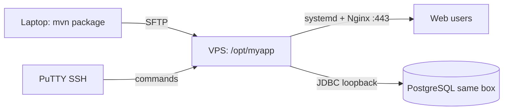

**Checklist:** DNS A record □ `ssh -i key` hardening (disable root password auth) □ UFW 22/80/443 □ Java 17 □ PostgreSQL + user/db □ `/etc/springboot.env` (chmod 600) □ systemd unit `After=postgresql.service` □ Nginx reverse proxy □ Certbot TLS auto-renew timer □ `journalctl` runbook page □ **Documented rollback = restore previous JAR manually.**

**You pass when:** `curl -I https://shop.example.com` returns 200 with valid TLS; `sudo reboot` → site back with zero manual steps; BF-01/02/12 reproduced & fixed on demand.

## Capstone 2 — Zero-Downtime Scripted Release Factory

**Brief:** Rebuild Capstone 1's deploy as `deploy.sh`/`rollback.sh`/`backup.sh` with releases + atomic symlinks, logrotate, nightly `pg_dump`, and a drilled restore.

**Checklist:** `releases/vN` convention □ atomic `ln -sfn` switch □ idempotent script (`set -euo pipefail`, `flock`) □ smoke test gates the switch □ rollback < 60 s □ logrotate weekly/4 □ cron 02:00 backups, 7-day retention □ **restore drill executed & timed** □ checksum verification (deployed jar == CI artifact).

**You pass when:** 3 consecutive deploys with `curl` loop showing zero failed requests; restore drill recovers `orders` table within RTO of 15 min; BF-21/22/23 demonstrated & fixed.

## Capstone 3 — Container-Sealed Environment (Docker)

**Brief:** Package app + DB as containers with multi-stage builds, non-root user, named volumes, resource limits, and a private network.

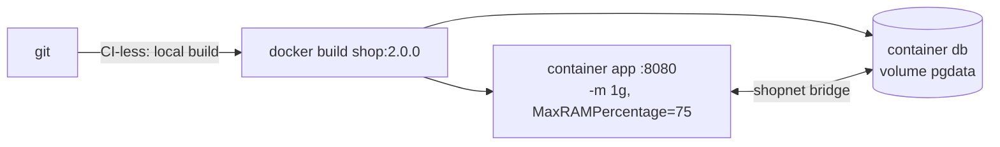

**Checklist:** multi-stage Dockerfile (Maven → JRE Alpine) □ `.dockerignore` □ non-root `USER` □ pinned base-image digests □ named volume + persistence test (rm/recreate) □ custom bridge network □ memory limits aligned with JVM flags □ `docker-compose.yml` (single file OK here, but no health ordering yet — that's C5) □ image size < 250 MB.

**You pass when:** `docker run` on a fresh cloud VM works from README alone; BF-31/32/33 reproduced & fixed; image scanned clean of CRITICAL CVEs (Trivy).

## Capstone 4 — Multi-Service Compose Stack with Health-Gated Startup

**Brief:** App + PostgreSQL + Redis + Nginx in Compose with healthchecks, depends_on conditions, `.env` secrets, two networks, and full lifecycle commands documented.

**Checklist:** 4 services □ `pg_isready` + `redis-cli ping` healthchecks □ `condition: service_healthy` □ app actuator probes enabled □ `frontend`/`backend` network split (DB & Redis unreachable from public side) □ `.env` (chmod 600) + `docker compose config` check □ `restart: unless-stopped` □ `make up/down/logs/backup` style helper documented □ backup service dumps DB to bind-mounted folder.

**You pass when:** `docker compose up -d` from a wiped machine reaches healthy in deterministic order 3/3 times; BF-37/38/39 reproduced & fixed; Redis actually caching (verify cache-hit metric).

## Capstone 5 — Cloud Landing Zone (VPC, ALB, RDS)

**Brief:** Re-platform Compose stack onto a 2-AZ VPC: ALB in public subnets, app in private, RDS Multi-AZ in isolated private subnets, SSM/SSH access only via bastion (no public app SSH).

```mermaid
flowchart LR
    U -- 443 --> ALB[ALB public AZ-a/AZ-b]
    ALB -- 8080 --> APP1[app VM priv-a]
    ALB -- 8080 --> APP2[app VM priv-b]
    APP1 & APP2 -- 5432 --> RDS[(RDS PostgreSQL Multi-AZ<br/>isolated priv subnets)]
    BAST[((Bastion :22<br/>your IP only)) -. SSM/SSH .-> APP1
```

**Checklist:** VPC + 4 subnets (2 pub, 2 priv-app, 2 priv-db) □ IGW + NAT □ SG chain ALB→app→RDS (quiz-gated) □ Bastion or SSM (no 0.0.0.0/0:22 anywhere except bastion) □ RDS encrypted, automated backups 7d □ HikariCP pool math documented (instances × pool < 80% max_connections) □ S3 for uploaded files w/ presigned URLs □ CloudWatch/basic alarms: ALB 5xx, RDS connections, disk.

**You pass when:** external port scan shows only 80/443; kill one app VM → 100% success through ALB; BF-42/43/44 reproduced & fixed.

## Capstone 6 — CI Pipeline with Quality Gates (No Deploy Yet)

**Brief:** GitHub Actions: every PR runs unit + Testcontainers integration tests, Trivy + OWASP dependency check, builds and pushes `1.0.0-<sha>` images to GitHub Packages/ECR. Deploy remains manual.

**Checklist:** workflow on PR + main □ Testcontainers Postgres for `@DataJpaTest` suites □ Trivy fs scan fails on HIGH/CRITICAL □ OWASP dependency-check archived as artifact □ immutable SHA tags, no `:latest` □ `actions/cache` for Maven □ branch protection: CI must pass to merge □ provenance: `/actuator/info` carries git SHA (build plugin) □ secrets via GitHub Secrets only.

**You pass when:** a deliberately failing test blocks merge; a seeded vulnerable dependency fails the scan; pushed image tag equals merged commit SHA.

## Capstone 7 — Full CD: Auto-Deploy with Smoke Test & Auto-Rollback

**Brief:** Extend Capstone 6 to auto-deploy to the Capstone-5 cloud via SSH (or SSM): pull pinned tag, rolling compose update, smoke test, automatic rollback on failure.

**Checklist:** deploy job (environment: production, protected) □ server compose uses `IMAGE_TAG` injected from pipeline □ `docker compose pull && up -d` (no build on prod) □ smoke: `/actuator/health` + one business endpoint □ rollback = re-point tag & up (scripted, < 2 min) □ deploy notification (Slack/webhook sim) □ **game day:** push a 503-breaking commit → watch auto-rollback keep prod green.

**You pass when:** full lead time push→prod < 10 min; broken deploy self-heals with zero SSH; BF-47/48/49 reproduced & fixed.

## Capstone 8 — Kubernetes Single-Cluster Production

**Brief:** Migrate Capstone 7's workload to a managed k8s cluster (or kind for sim): Deployments, Services, Ingress+TLS, StatefulSet+PVC DB, ConfigMap/Secret, probes, HPA, PodDisruptionBudget.

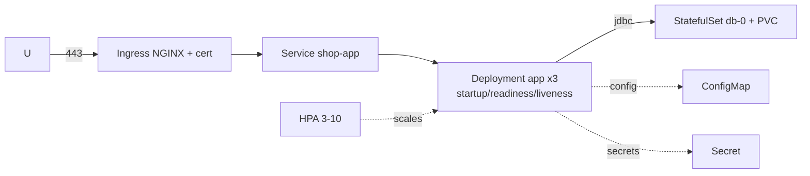

**Checklist:** namespaces `prod`/`staging` □ resource requests/limits everywhere □ **startupProbe** tuned for JVM boot □ Secret typo game (BF-50-family) documented □ Ingress TLS (cert-manager) □ HPA on CPU + custom metric (HTTP rate) □ PDB minAvailable 1 □ `kubectl rollout undo` rehearsed □ logs via `kubectl logs`/Loki-basic; `kubectl top` works (metrics-server).

**You pass when:** `kubectl delete pod` invisible to a running `curl` loop; rolling v1→v2→`rollout undo` all zero-downtime; HPA visibly scales under chaos-load; BF-46-family (Pending/resources) diagnosed from Events.

## Capstone 9 — Progressive Delivery: Canary + Blue-Green at Traffic Level

**Brief:** On top of Capstone 8: canary releases via Ingress canary annotations (5% → 25% → 100%) with automated metric gating (error rate < 1%, p99 latency baseline) and instant full rollback.

**Checklist:** two Deployments (stable/canary) behind weighted Ingress □ canary headers/cookie option for staff preview □ Prometheus + Grafana dashboards: error rate, p99, per-version □ automated promotion script (weight steps + checks) □ auto-abort on SLO breach □ blue-green variant documented for the DB-migration case (expand/contract migrations) □ **game day:** canary with a 5%-only bug → abort fires, 0% user impact beyond canary window.

**You pass when:** a bad release never exceeds its canary percentage; promotion & abort both scriptable one-liners; learners can read the Grafana diff between versions.

## Capstone 10 — Multi-Environment GitOps: K8s + HA PostgreSQL (Course Summit)

**Brief:** GitOps with ArgoCD: `main` branch = production desired state; dev/staging/prod clusters (or namespaces) promoted automatically; HA PostgreSQL via CloudNativePG (or managed RDS) with automated failover; secrets via External Secrets Operator; full observability; disaster-recovery runbook executed.

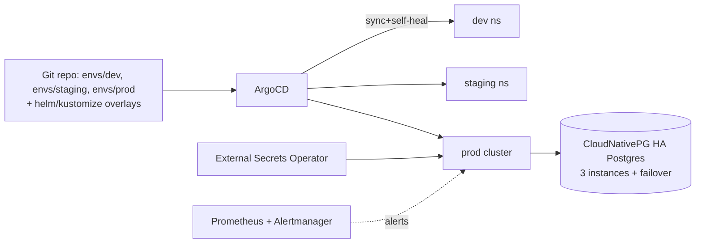

**Checklist:** repo structure per env (Kustomize overlays) □ ArgoCD auto-sync + self-heal + prune □ promotion = PR merge (no kubectl in prod) □ image updater pins tags per env □ CloudNativePG cluster (3 pods, failover drill: kill primary → promote standby < 30 s) □ External Secrets from a sealed/secret store (no plain Secrets in git) □ NetworkPolicies (default-deny + explicit allows) □ backup: WAL archiving + scheduled dumps + **timed restore drill to a scratch cluster** □ golden signals dashboards + paging alert (error-budget burn) □ DR runbook: full region-loss tabletop executed in simulator.

**You pass when (graduation gate):** a commit merged to `main` flows dev→staging→prod automatically with gates; DB primary kill causes < 30 s blip with zero data loss; restoring the entire stack to a "new region" (simulator reset) completes inside RTO 60 min from runbook alone.

---
# REFERENCE SECTION 4 — Frontend Data Schema & JSON Blueprint for Claude.ai

Purpose: these interfaces let Claude.ai render every course element (Imagine cards, diagrams, tables, playground, chaos labs) in React/Next.js without structural ambiguity. All content in this document maps 1:1 onto these types.

## 4.1 Core TypeScript Interfaces

```typescript
// ---------- Course skeleton ----------

interface CourseModule {
  id: string;                       // "devops-mastery-spring-postgres"
  title: string;                    // "Full-Stack Deployment & DevOps Mastery"
  stages: CourseStage[];            // exactly 8, ordered, gated
  referenceSections: ReferenceSection[]; // command encyclopedia, 50 scenarios, capstones
  globalPlayground: PlaygroundSpec; // split-screen contract from §0.3
}

interface CourseStage {
  id: string;                       // "stage-1-manual-vps"
  number: 1 | 2 | 3 | 4 | 5 | 6 | 7 | 8;
  title: string;
  eraName: string;                  // "Manual Bare-Metal / VPS Deployment"
  unlockGate: UnlockGate;           // conditions to open stage N+1
  imagineCard: ImagineAnalogyBlock;
  architectureFlow: DiagramSpec[];  // ASCII + mermaid + before/after diff
  labs: InteractiveLab[];
  chaosLabs: ChaosIncident[];       // exactly 2–3 per stage
  painPointTable: ComparisonTable;  // problem→solution rows (1D, 2D, ...)
  cheatSheet: ComparisonTable;      // stage-specific ports/config table
}

// ---------- Pillar 1: Imagine cards ----------

interface ImagineAnalogyBlock {
  headline: string;                 // "Your First Empty Shop"
  analogy: string;                  // long-form story (2–4 paragraphs)
  mappingTable: ComparisonTable;    // concept ↔ physical-world object
  illustrationPrompt: string;       // AI image prompt for the card art
}

// ---------- Pillar 2: Diagrams ----------

interface DiagramSpec {
  id: string;                       // "stage-2-flow"
  kind: "ascii" | "mermaid-flowchart" | "mermaid-sequence" | "before-after-diff";
  title: string;
  caption?: string;
  mermaidCode?: string;             // validated before render
  asciiArt?: string;                // monospaced, < 100 cols
  beforeAscii?: string;             // for before-after-diff
  afterAscii?: string;
  highlightedPorts?: number[];      // [80, 443, 8080, 5432] — UI pulses these
  highlightedProtocols?: ("HTTP" | "HTTPS" | "TCP" | "JDBC" | "SSH" | "SFTP")[];
  nodes?: TopologyNode[];           // interactive topology graph version
}

interface TopologyNode {
  id: string; name: string;
  kind: "laptop" | "proxy" | "app" | "database" | "cache" | "ci" | "registry" | "k8s-cluster";
  x: number; y: number;             // canvas coordinates, responsive-normalized
  edges: { to: string; protocol: string; port?: number; label?: string }[];
}

// ---------- Pillar 3: Tables ----------

interface ComparisonTable {
  id: string;
  title: string;
  description?: string;
  columns: string[];                // e.g. ["Command","Plain-English Meaning","Example","Pro-Tip / Trap"]
  rows: string[][];                 // rows[i].length === columns.length — enforced
  rowSemantics?: string[];          // optional per-row type hint, e.g. "tool-translation"
}

// ---------- Pillar 4: Labs & Chaos ----------

interface InteractiveLab {
  id: string;                       // "lab-1-2"
  title: string;
  objective: string;                // one sentence, non-technical friendly
  steps: LabStep[];
  environment: "terminal" | "filezilla-sftp" | "docker" | "compose" | "cloud-console" | "kubectl" | "github-actions";
  estimatedMinutes: number;
}

interface LabStep {
  instruction: string;              // learner-facing
  command?: string;                 // exact command to type
  expectedOutput?: string;          // simulator match string (may be regex)
  validation: TerminalCommandRule;  // machine-checkable rule
  hintAfterAttempts: number;        // show progressive hint after N failures
  hintText?: string;
}

interface TerminalCommandRule {
  kind: "exact" | "regex" | "file-exists" | "process-running" | "port-listening"
      | "state-equals" | "output-contains-all" | "sequence";
  pattern?: string;                 // command or regex
  args?: string[];
  expected?: string | number | boolean;
  caseSensitive?: boolean;          // default false
  onFailMessage?: string;           // realistic error shown instead of "wrong"
}

interface ChaosIncident {
  id: string;                       // "chaos-4-1"
  title: string;
  injectionScript: string;          // how the simulator breaks the world
  symptom: string;                  // what learner sees (UI + alert badge)
  imagineAnalogy: string;           // the "what broke" story
  diagnosticTrail: LabStep[];       // ordered commands with validation
  exactFix: LabStep[];
  lesson: string;                   // the one-line takeaway
  relatedScenarios: string[];       // BF-xx IDs from Reference Section 2
}

// ---------- Playground & state ----------

interface PlaygroundSpec {
  layout: "split-vertical";         // terminal left/bottom, topology right/top
  terminal: {
    shell: "bash";
    supportedCommands: string[];    // see §4.3
    filesystem: VirtualFileSystemNode; // initial state snapshot per stage
    editor: "nano" | "vim";         // simplified keybinding sim
  };
  topology: { nodes: TopologyNode[]; showHealthBadges: true };
}

interface VirtualFileSystemNode {
  name: string;
  type: "file" | "dir";
  content?: string;
  permissions?: string;             // "644" — drives chmod chaos labs
  children?: VirtualFileSystemNode[];
}

/** The hidden causal state machine — must satisfy ALL chaos labs' preconditions. */
interface SimulatedServerState {
  stage: number;
  server: {
    hostname: string; publicIp: string; os: "ubuntu-22.04";
    uptimeSeconds: number; rebootPending: boolean;
  };
  packages: { java17: boolean; java21: boolean; postgresql: boolean; nginx: boolean; docker: boolean };
  processes: { appPid: number | null; appManagedBy: "none" | "nohup" | "systemd" | "docker" | "kubelet" };
  listeners: Record<string, number | null>; // {"8080": pid|null, "5432": pid|null, "80": pid|null, "443": pid|null, "22": pid}
  firewall: { ufwEnabled: boolean; allowedPorts: number[] };
  files: Record<string, { exists: boolean; contentHash: string; permissions: string }>;
  disks: { rootUsedPct: number; varLogUsedPct: number };
  systemd: { springbootService: "enabled-running" | "disabled" | "failed" | "restart-loop" };
  releases: { current: string | null; versions: string[]; brokenSymlink: boolean };
  docker: { containers: Record<string, "running" | "exited" | "restarting">;
            networks: string[]; volumes: string[];
            oomKilled: boolean; memoryLimitBytes: number | null };
  compose: { healthy: Record<string, boolean>; envResolved: Record<string, string> };
  cloud: { vpcOk: boolean; sgChainOk: boolean; albTargetsHealthy: number; natOk: boolean;
           rdsReachable: boolean; hikariPool: { active: number; pending: number; max: number } };
  ci: { pipelineStatus: "idle" | "testing" | "building" | "deploying" | "smoke-failed-rollback";
        lastImageTag: string | null; secretsPresent: Record<string, boolean> };
  k8s: { pods: Record<string, { status: "Running" | "Pending" | "CrashLoopBackOff"
                              | "ImagePullBackOff" | "OOMKilled"; restarts: number }>;
         deployments: Record<string, { replicas: number; updatedReplicas: number; image: string }>;
         secrets: Record<string, Record<string, string>>; // exact keys incl. typo traps
         pvcBound: boolean; hpaReplicas: { min: number; max: number; current: number } };
}

// ---------- Reference sections ----------

interface ReferenceSection {
  id: "command-encyclopedia" | "breakfix-50" | "capstones-10";
  tables: ComparisonTable[];
}

interface BreakFixScenario {
  id: string;                       // "BF-01" … "BF-50"
  stage: number;
  analogy: string; errorSnippet: string; rootCause: string;
  diagnosticCommand: string; resolution: string;
  chaosIncidentRef?: string;        // links back into a stage's ChaosIncident
}

interface CapstoneProject {
  number: 1 | 2 | 3 | 4 | 5 | 6 | 7 | 8 | 9 | 10;
  title: string; brief: string;
  diagram: DiagramSpec;
  checklist: string[];              // ordered, checkbox-rendered
  passGate: string;                 // acceptance criteria
  stageRefs: number[];              // which stages it composes
}
```

## 4.2 JSON Instance Example (Stage 1 skeleton — demonstrates the shape)

```json
{
  "id": "stage-1-manual-vps",
  "number": 1,
  "title": "Manual Bare-Metal / VPS Deployment",
  "eraName": "The PuTTY & FileZilla Era",
  "imagineCard": {
    "headline": "Your First Empty Shop",
    "mappingTable": {
      "columns": ["Concept", "In the Analogy"],
      "rows": [
        ["VPS / IP address", "The rented empty shop and its street address"],
        ["Port 8080 / 5432", "Door numbers: kitchen door vs. stockroom door"],
        ["FileZilla (SFTP)", "The delivery van you drive yourself"],
        ["PuTTY (SSH)", "The walkie-talkie to a worker inside"],
        [".pem key", "The one-of-a-kind skeleton key (keep in your pocket: chmod 400)"]
      ]
    }
  },
  "chaosLabs": [
    {
      "id": "chaos-1-1",
      "injectionScript": "killProcessTree(appPid, signal='SIGHUP')",
      "symptom": "curl: (7) Failed to connect to localhost port 8080: Connection refused",
      "relatedScenarios": ["BF-01"]
    }
  ]
}
```

## 4.3 Terminal Simulator Supported Command Set (per stage, progressive unlock)

| Stage | Newly unlocked commands |
|---|---|
| 1 | `ls cd pwd cat echo mkdir rm cp mv chmod chown ps kill grep tail head find ssh scp sftp curl wget apt systemctl(no) java -jar nohup & ss` |
| 2 | `systemctl journalctl nginx -t/-T ufw certbot ln -s(-fn) nano` |
| 3 | `bash scripting: set -euo pipefail, variables, if, rsync, crontab, logrotate, pg_dump/mysqldump, psql/mysql, gzip, date, flock` |
| 4 | `docker build/run/ps/logs/exec/stop/rm/inspect/network/volume/stats/images/history tag` |
| 5 | `docker compose up/down/ps/logs/config/exec/top` |
| 6 | (cloud-console UI sim) + `nc dig htop iostat aws ec2/rds/s3 (read-only variants)` |
| 7 | `git add/commit/push/branch, gh workflow/secrets view, docker push` + YAML editor |
| 8 | `kubectl get/describe/logs/apply/delete/exec/rollout(scale,status,undo, history)/port-forward/top/scale/config, helm status` |

## 4.4 Rendering Rules for Claude.ai

1. **Imagine cards render first, always.** Technical content is visually collapsed until the card is marked "read" (scroll-depth or explicit click).
2. **Diagram dual-render:** Mermaid for clean flow, ASCII preserved in a toggleable "raw" tab — non-IT learners often find ASCII boxes easier to scan than abstract node graphs.
3. **Health badges** on the topology map must read from `SimulatedServerState` (§4.1) — never from the lesson text. Badges: `🟢 RUNNING` `🔴 CRASHED` `🟠 502 BAD GATEWAY` `🔴 DB_CONN_REFUSED` `🟡 PENDING` `🔴 CrashLoopBackOff`.
4. **Terminal validation** uses `TerminalCommandRule`; a failed rule renders `onFailMessage` (the real-world error) — never a generic "incorrect."
5. **Stage gating** enforces the `unlockGate` (labs complete + chaos labs fixed + quiz pass) before Stage N+1 content is fetchable.
6. **Before/After diagrams** render side-by-side with an animated arrow — this is the single most effective visual for non-IT learners.
7. All tables validate `rows[i].length === columns.length` at build time.

---

# Appendix A — Course Glossary (Analogy-Anchored)

| Term | One-line non-technical definition | Anchor |
|---|---|---|
| IP Address | The street address of a machine on the network. | Shop address |
| Port | A door number in the building. | 8080 kitchen, 5432 stockroom |
| SSH / PuTTY | A walkie-talkie to command a remote machine. | Stage 1 |
| SFTP / FileZilla | The delivery van for files. | Stage 1 |
| systemd | The building manager + backup generator. | Stage 2 |
| Nginx | The front-desk receptionist. | Stage 2 |
| TLS/HTTPS | The official ID badge at the front desk. | Stage 2 |
| Reverse proxy | Visitors meet the receptionist, never the kitchen. | Stage 2 |
| Symlink / atomic deploy | The railroad track switch. | Stage 3 |
| logrotate | The recycling program. | Stage 3 |
| Docker image/container | The standardized shipping container. | Stage 4 |
| Volume | The dockside warehouse. | Stage 4 |
| OOMKilled (137) | The dock safety officer slamming the kitchen. | Stage 4 |
| Compose | The conductor's musical score. | Stage 5 |
| Healthcheck | "Wait until the drummer is actually playing." | Stage 5 |
| VPC | The walled smart city. | Stage 6 |
| Security Group | The chained bouncers with guest lists. | Stage 6 |
| RDS | The city-run bonded warehouse. | Stage 6 |
| Connection pool / HikariCP | The fleet of delivery scooters. | Stage 6 |
| CI/CD | The airport X-ray baggage system. | Stage 7 |
| Git SHA tag | The unforgeable baggage tag. | Stage 7 |
| Kubernetes | The autonomous fleet commander. | Stage 8 |
| Pod / Service / Ingress | Ship / harbor address / port authority gate. | Stage 8 |
| Probes (startup/readiness/liveness) | Loading-grace inspector / harbor inspector / coast guard. | Stage 8 |
| StatefulSet + PVC | Warehouse fleet + permanent dock space. | Stage 8 |
| HPA | The reinforcement commander. | Stage 8 |

# Appendix B — Build Validation Checklist (for Claude.ai ingestion)

- [x] 8 stages, each with (a) imagine_card, (b) architecture_flow (ASCII + Mermaid), (c) step-by-step labs with `TerminalCommandRule`-style validation tables, (d) 2–3 chaos labs with symptom/analogy/diagnostic trail/exact fix, (e) pain-point table unlocking next stage.
- [x] Before-vs-after upgrade diagrams for every stage transition.
- [x] Reference Section 1: command encyclopedia in tables across Linux, SSH/SFTP, JVM/Spring, PostgreSQL/MySQL, Nginx, Docker, Compose, Git/CI, kubectl.
- [x] Reference Section 2: 50 break-fix scenarios with all 7 required columns.
- [x] Reference Section 3: 10 capstone blueprints with diagrams, checklists, pass gates.
- [x] Reference Section 4: complete TypeScript interfaces + JSON instance + simulator command sets + rendering rules.
- [x] Constant throughline: same Spring Boot + PostgreSQL/MySQL app deployed identically across all stages; unlock gating defined per stage.
- [x] No placeholders, no truncation, no "add more here" markers.

*End of specification.*
